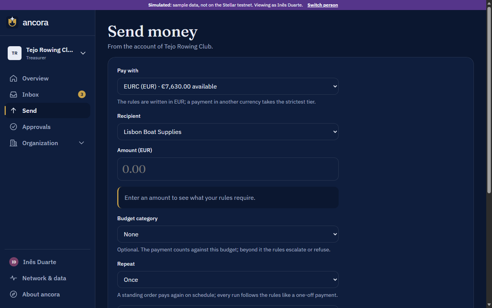
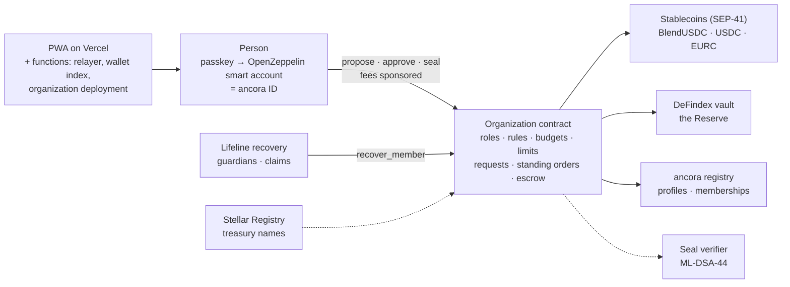

<p align="center">
  <picture>
    <source media="(prefers-color-scheme: dark)" srcset="app/public/brand/lockup-dark.svg" />
    
  </picture>
</p>

<h3 align="center">The business account your organization controls.</h3>

<p align="center">
  A programmable stablecoin account for clubs, companies, NGOs and teams.<br/>
  One passkey per person, one contract per organization, rules the account enforces itself.<br/>
  Feels like a modern banking app; runs on Stellar in the background.
</p>

<p align="center">
  <a href="https://ancora-gray.vercel.app"></a>
  <a href="https://github.com/raglibol-re/ancora/actions/workflows/ci.yml"></a>
  
  
  
</p>

<p align="center">
  
</p>

<p align="center">
  <sub>Thirty seconds of the real app on sample data (every such screen is labeled <em>Simulated</em>). On the Stellar testnet the same screens read from the organization's own contract.</sub>
</p>

<p align="center">
  <strong>Live:</strong> <a href="https://ancora-gray.vercel.app">ancora-gray.vercel.app</a> &nbsp;·&nbsp; <strong>Built for</strong> HackMeridian 2026, Lisbon &nbsp;·&nbsp; <strong>Next:</strong> Stellar Community Fund #46
</p>

> ancora is not a bank. Balances are not deposit-insured and nothing here is a savings account. This project runs on the Stellar **testnet** only; no real money is involved.

## Try it in two minutes

1. Open **[ancora-gray.vercel.app](https://ancora-gray.vercel.app)** and tap **Get started**. Your passkey (Face ID, fingerprint or device PIN) creates your pass: your own account on Stellar, no seed phrase, no XLM to buy.
2. **Create an organization** from a template (club, company or team). It is deployed as its own contract with you as founder.
3. **Add money** on the overview and take test BlendUSDC from ancora's operator.
4. **Send money**: the rule preview tells you live what your rules require. Approve from the inbox with a second pass, or in sample mode with "Viewing as".
5. Then explore: move money into the **Reserve**, edit **budgets and spending limits** on the Rules page, set a **standing order**, mark a payment as a **secure handover**, name your treasury on the **Stellar Registry**, or add **guardians** for recovery.

Everything above runs on the Stellar testnet with real contracts. If the testnet or ancora's server doesn't answer, the app falls back to sample data and says so.

## Why ancora

**The problem.** Organizations want to use stablecoins, but no treasurer puts company money in an account that is lost with a seed phrase, that one person can empty, that earns nothing, and that a quantum computer could crack in ten years.

**The answer.** Put the organization's rules into the account itself.

- **You are your passkey.** It creates your own OpenZeppelin smart account on Stellar; its address is your *ancora ID*, which holds any number of positions in any number of organizations. Fees are sponsored, so nobody buys XLM.
- **Each organization is its own contract.** It holds the money and enforces the approval rules: tiers per amount, four-eyes, objection windows, extra approval for new recipients, budgets per category, spending limits per person. The rules are one readable document whose fingerprint the contract stores, so anyone can verify them.
- **Several stablecoins, one home currency.** BlendUSDC, Circle USDC and Circle EURC are preset; any Stellar asset can be accepted by reference. Payments in another currency take the strictest tier until a live rate is connected.
- **A Reserve, not a savings account.** Idle money goes into a DeFindex vault (Blend lending on testnet) with one tap and comes back whenever needed; earnings are variable and shown as they come in.
- **Quantum-safe seal.** Large payments need an extra seal; ancora's own ML-DSA-44 (FIPS 204) verifier runs on Stellar, ready for the day today's signatures can be forged.
- **Continuity.** A second passkey, and Lifeline guardians who hand your positions to a new pass after a waiting period. Control is restored; money never moves.
- **Euro and dollar in and out** through Stellar anchors (SEP-24): the anchor's form, your wallet's signature, no bank details in ancora.

## What runs on the Stellar testnet today

| | |
|---|---|
| **Passkey accounts** | smart-account-kit 0.8 wallets on OpenZeppelin smart accounts; ancora serves the kit's wallet index itself, so a passkey signs in on any device |
| **Organization contract** | roles (OpenZeppelin AccessControl), tiered approvals, four-eyes, objection windows, seal threshold, budgets, spending limits, requests, standing orders, secure handover, any SEP-41 token, Reserve moves, logo, Lifeline handover |
| **Registry** | profiles with picture, organizations per person; treasury names on the Stellar Registry's open channel |
| **Reserve** | DeFindex USDC vault on the Blend strategy, value and earnings read from the vault |
| **Seal verifier** | ML-DSA-44 signatures verified on-chain, interoperable with `@noble/post-quantum` |
| **Lifeline** | guardians, threshold, waiting period, claims, cancel by the old pass, handover of every position |
| **Money in and out** | Freighter, Hana, xBull and Albedo deposits; SEP-10 and SEP-24 with the SDF test anchor; test money from the operator's float |
| **Activity** | the organization's movements read from the ledger's events, each with its transaction on the explorer; CSV statement |
| **Sponsored fees** | a fail-closed relayer that only ever pays for calls to ancora's own contracts |

## Screens

<p align="center">
  
  
  
  
  
  
</p>

## Features

| Module | What it does | Status |
|--------|--------------|--------|
| App shell | Installable PWA, pinned top bar and side panel, phone drawer and tabs, light/dark, org switcher with open-item badges, cross-org inbox, a working bar for every on-chain step | Real |
| App screens | Overview, Inbox, Approvals, Send money with live rule preview, Rules, Organization settings, New organization, your pass | Real; runs on sample data or the Stellar testnet (switch on your pass) |
| Identity ("your pass") | Passkey sign-in and sign-out, on-chain profile (name, picture), ancora ID with QR code, your positions, recovery status, device preferences | **Real on testnet** (sample mode uses "Viewing as") |
| Approval rules | Tiered approvals, four-eyes, objection window, seal threshold, membership and rule requests, setup phase, lock-out guard | **Real on testnet**: enforced by the organization contract (Rust, tested against the same vectors as the TypeScript engine); the rules document hash is verified on the Rules page |
| Organizations on Stellar | Each organization is an `ancora_organization` contract with OpenZeppelin AccessControl roles; people are invited by ancora ID; payments leave the contract once its rules are satisfied; fees sponsored by ancora's relayer | **Real on testnet** |
| Notifications | Web push on any device that allows it (on iPhone once ancora is on the home screen): a payment or change waits for your approval, your request was done, approved or declined, a guardian started recovering your pass. Turned on per device on your pass page. Messages only repeat what is public on the ledger | **Real on testnet** (the relayer notifies after a successful transaction; subscriptions per device in Vercel Blob) |
| Payment links | Ask for money: an invoice (one payer) or a fee (up to 500 payers, each once) as a link or QR code. The payer opens a public page, connects any Stellar wallet and pays; the organization's contract records who paid and when, and members see it on Organization → Payment links | **Real on testnet** (`create_link`, `pay_link`, `close_link`, views `links`, `link`, `link_payments`; interface `version()` 6; the payer signs with their own wallet and pays their own fee) |
| Batch payments | Payroll and reimbursements: up to 50 payments in one asset as one request (Send money → Several). The rules judge the total (tier, budget, spending limit; any new recipient counts), it is approved once, and every line is paid out in the same transaction, or none | **Real on testnet** (`propose_batch` in the organization contract, interface `version()` 5; organizations created before 28 Oct 2026 send one payment at a time) |
| Activity and statements | The full history on its own page: search by name, reference, category or amount; filter by direction, asset and month; totals in and out; CSV of exactly what is shown. A monthly statement per asset (money in, money out, net, balance today, every movement) that prints or saves as PDF through the browser | **Real** (on testnet built from the contract's payments and the ledger's events) |
| Address book | Saved recipients shared by every member: name, address, note, who saved it, when the organization last paid them, a Pay button. Tick "Save to the address book" when paying someone new; recipients paid before but not saved are listed separately | **Real on testnet** (`set_payee`, `remove_payee`, `payees` in the organization contract, interface `version()` 4; up to 200 recipients; organizations created before 28 Oct 2026 list paid recipients read-only) |
| Custom roles | The organization's own roles, highest first: add a role ("Coach", "Project lead"), reorder, remove roles nobody holds. A higher role approves wherever a lower one is asked for. Saved as one rule change (directly in the setup phase, otherwise a request under the strictest tier); refused if someone still holds a removed role or the tiers still ask for it | **Real on testnet** (`SetRoles` in the organization contract, interface `version()` 3; organizations created before 28 Oct 2026 show their roles read-only) |
| Standing orders | A payment repeated weekly, fortnightly or monthly, set from the Send page. Every run goes through the organization's rules like a one-off payment: inside the spending limit it pays out at once, otherwise it waits for approvals. Due orders run every day by ancora's scheduler, when the organization is opened, or with "Run now"; the person who set it or the top role stops it | **Real on testnet** (organization contract; a Vercel cron calls `/api/due` daily; organizations created before 26 Oct 2026 12:00 don't have it) |
| Activity | Movements of the organization's money read from the ledger's events (deposits, payments, Reserve moves, each with its transaction on the explorer), plus approved changes from the request list; CSV statement | **Real on testnet**: Soroban RPC keeps about a week of events, read in chunks and kept on the device so the list outlives the week |
| Add money from your wallet | Connect Freighter, Hana, xBull or Albedo (Stellar Wallets Kit); ancora builds the token transfer to the organization's contract and the wallet signs it; test money per asset from the operator's float; the organization's address for wallets that can pay contracts | **Real on testnet** (BlendUSDC test money today: Circle's testnet faucet is down, so the USDC and EURC floats are empty and the sheet says so) |
| Multi-asset treasury | Balances per accepted stablecoin, payments in each, home currency (EUR or USD) for the rules with the strictest tier for other currencies. Accept any Stellar asset from the Rules page by contract address or CODE:ISSUER: the token describes itself, the contract verifies it when the change is applied, an optional DeFindex vault gives it a Reserve | **Real on testnet** (BlendUSDC, Circle USDC, Circle EURC preset; any SEP-41 token by reference) |
| Reserve on DeFindex | Per-asset Reserve in a DeFindex vault: one-tap moves by the top role or any strictest-tier approver, value and earnings read from the vault | **Real on testnet** for BlendUSDC (the DeFindex testnet vault); **Simulated** in sample data |
| Security seal (ML-DSA) | Payments above the seal threshold need an extra seal; ancora's `ancora_seal_verifier` contract checks ML-DSA-44 (FIPS 204) signatures on Stellar | **Verifier real on testnet** (tested on-chain with a shared vector); the seal step in the app is signed by an approver's passkey until the ML-DSA key lives on the approving device (roadmap) |
| Crew / agent keys | A spending limit per member (amount per day, week or 30 days in the rules' currency): payments inside it go out without approvals, beyond it the normal rules apply; an agent is simply a member whose key has a limit | **Real on testnet** (organization contract) |
| Bank in/out (SEP-24) | Deposits and withdrawals through a Stellar anchor: the wallet signs in (SEP-10), the anchor's own form takes the bank details, deposits land in the wallet and move on to the organization, a withdrawal becomes a payment request to the anchor with its reference | **Real on testnet** with the SDF test anchor (protocol verified end-to-end; the hosted form was not clicked through in a browser yet); euro IBAN card in sample data **Simulated** |
| Budgets and bookkeeping | Budgets are rules: an envelope per category and rolling period in the home currency, enforced by the organization contract. A payment tagged with a category counts against it; beyond what is left a soft budget escalates to the strictest tier and flags the request, a hard budget refuses it. Edited on the Rules page like any rule change; statement export as CSV | **Real on testnet** (organization contract; sample data mirrors it) |
| Money view | Headline total in the home currency including other assets at an indicative ECB reference rate (display only, never used by the rules), with an allocation bar: available, waiting in requests, in the Reserve | **Real** (rates via Frankfurter; a fixed **Simulated** rate when no service answers) |
| Lifeline recovery | Guardians (other ancora passes), a threshold and a waiting period per person; a guardian starts a claim for the new pass, others confirm, the old pass can cancel while it waits; afterwards every organization hands the person's position and spending limit to the new pass. Restores control, never money | **Real on testnet** (`ancora_recovery` contract; organizations created from 26 Oct hand over positions, older ones are listed as not recoverable); **Simulated** in sample data |
| Second passkey | Add another passkey to the same account from the pass page: a security key, this device, or another phone through the browser's QR flow; signed by the current passkey, fees sponsored. A reminder nudges a pass with one passkey and no guardians | **Real on testnet** (smart-account-kit `signers.addPasskey`; not yet clicked through with a hardware key) |
| Secure handover (escrow) | A payment can be marked as a secure handover: after approval the money is set aside in the organization's contract and paid out only once the recipient and the organization both confirm; the sender's side can cancel and free the money. The recipient confirms through a link, signed in with their own pass, without being a member | **Real on testnet** (organization contract; the recipient page is not yet clicked through with two passes); **Simulated** recipient confirmation in sample data |
| Name on the Stellar Registry | The highest role registers the organization's treasury contract under a name in the Stellar Registry's open channel (`register_contract`, signed by their pass); the app checks availability, remembers the name and verifies it resolves to the contract | **Real on testnet** (registry root `CAAXJE…HI4M`, open channel `CDBL7M…HY4S`; not yet clicked through with a passkey) |
| Discussions on requests | Pro and contra reasons, questions (the requester marks them answered) and comments with thumbs up/down, one reaction per person; summary on every request card | **Real** (off-chain in Vercel Blob, membership checked against the contract; entries aren't passkey-signed yet) |
| Demo admin | `/admin` (passphrase): site-wide demo mode with automatic fallback, health panel (RPC, testnet rent, contracts, operator floats), recent errors, sample reset | Real (operator tool, testnet only) |
| Confidential payments | Hidden amounts with auditor view | Roadmap |

The full plan, with what was built and what comes next, is in [docs/ROADMAP.md](docs/ROADMAP.md).

## How it works



A person signs with their passkey through their own account; the organization contract checks its own rules and moves the money. ancora's server never holds a key that can act for an organization: the operator deploys organizations, sponsors fees and sends test money, nothing more.

- **App**: Vite + React + TypeScript PWA with a strict layering: `domain/` (pure rules engine, money, request lifecycle, fully unit-tested), `adapters/` (the only code touching Stellar, the kit, DeFindex, anchors, Blob), `features/` (screens), `ui/` (shared components), one `tokens.css` for every colour and spacing.
- **Contracts**: a Rust workspace (`soroban-sdk` 28, OpenZeppelin `stellar-access` 0.8) with one crate per contract and shared test vectors, so the TypeScript engine and the contract agree on every rule.
- **Functions**: `/api/relay` (fail-closed fee sponsorship), `/api/create-organization`, `/api/due` (requests past their objection window, standing orders, the daily scheduler, the organization index), `/api/notifications` (web-push subscriptions), `/api/test-money`, `/api/finish-recovery`, `/api/wallet-index` (the smart-account index the passkey kit verifies wallets with), `/api/registry-name`, `/api/discussions`, `/api/upload-image`, `/api/health`, `/api/admin`.

Details: [docs/ARCHITECTURE.md](docs/ARCHITECTURE.md) · Why things are the way they are: [docs/DECISIONS.md](docs/DECISIONS.md) · [CHANGELOG.md](CHANGELOG.md)

## Testnet contracts

Verified and written to `app/.env.testnet` by `scripts/setup-testnet.sh`, which also builds, uploads and deploys ancora's own contracts from `contracts/`.

| What | Contract | Source |
|------|----------|--------|
| ancora registry (profiles, organizations per person) | [`CDPQV7…4QCM`](https://stellar.expert/explorer/testnet/contract/CDPQV7C2XRWVDGWBIEHNE6IOMC56KSAITMESJBI7BULJSIGSVAQD4QCM) | `contracts/registry` |
| ancora seal verifier (ML-DSA-44, OpenZeppelin external-verifier interface) | [`CDUFVN…V4NS`](https://stellar.expert/explorer/testnet/contract/CDUFVNCHZE64O37RQZQQ6ZKYDLS3RZ6YKYJDD66XNEPYHVWW6OO6V4NS) | `contracts/seal_verifier` |
| ancora Lifeline recovery (guardians, claims, handover) | [`CDO3YV…X2PE`](https://stellar.expert/explorer/testnet/contract/CDO3YV5KMKPZTJLTLODIKNBYSTPJYLDKFKXOAGE52NJXF7FZMLACX2PE) | `contracts/recovery` |
| ancora organization (one instance per organization) | Wasm (interface 6), see `VITE_ORG_WASM_HASH` in `app/.env.testnet`, deployed by the operator on "Create organization" | `contracts/organization` |
| Stellar Registry, open channel for treasury names | [`CDBL7M…HY4S`](https://stellar.expert/explorer/testnet/contract/CDBL7MNO7UI5OAAIC67UIWKQ4P3S6RVQSFCQXUHUW6TOFCXSYRPNHY4S) | stellar-registry/contracts |
| USDC (BlendUSDC, SAC of `USDC:GATALT…`) | [`CAQCFV…RCJU`](https://stellar.expert/explorer/testnet/contract/CAQCFVLOBK5GIULPNZRGATJJMIZL5BSP7X5YJVMGCPTUEPFM4AVSRCJU) | Blend testnet |
| EURC (Circle testnet, SAC of `EURC:GB3Q6Q…`) | [`CCUUDM…MCGZ`](https://stellar.expert/explorer/testnet/contract/CCUUDM434BMZMYWYDITHFXHDMIVTGGD6T2I5UKNX5BSLXLW7HVR4MCGZ) | Circle |
| USDC (Circle testnet, SAC of `USDC:GBBD47…`) | [`CBIELT…DAMA`](https://stellar.expert/explorer/testnet/contract/CBIELTK6YBZJU5UP2WWQEUCYKLPU6AUNZ2BQ4WWFEIE3USCIHMXQDAMA) | Circle |
| Reserve: DeFindex USDC vault | [`CBMVK2…DWHN`](https://stellar.expert/explorer/testnet/contract/CBMVK2JK6NTOT2O4HNQAIQFJY232BHKGLIMXDVQVHIIZKDACXDFZDWHN) | paltalabs/defindex |
| DeFindex USDC Blend strategy | [`CALLOM…FSUY`](https://stellar.expert/explorer/testnet/contract/CALLOM5I7XLQPPOPQMYAHUWW4N7O3JKT42KQ4ASEEVBXDJQNJOALFSUY) | paltalabs/defindex |
| Passkey (WebAuthn) verifier | [`CC7EKI…OM3F`](https://stellar.expert/explorer/testnet/contract/CC7EKIHQP3TN4CARQDND6CEOY2UXLWWC2X5GHTD5NLAT7BG5GPZIOM3F) | stellar/smart-account-kit 0.8.0 |
| Ed25519 verifier | [`CAAVTM…HKN4`](https://stellar.expert/explorer/testnet/contract/CAAVTMCBXEIBPR64EAASKFXERVPYFZA2JYP5A3BG6PESWEFUJX5IHKN4) | smart-account-kit |
| Threshold policy | [`CB3FAT…BCEG`](https://stellar.expert/explorer/testnet/contract/CB3FATQKCIRIQOCYRUPCQ2KREQ7T4RPKS7EAEOZWPEPUKWEDRVROBCEG) | smart-account-kit |
| Spending-limit policy | [`CABXBY…IP5G`](https://stellar.expert/explorer/testnet/contract/CABXBYJNZ7IUW4G3D6BND5YCAQF3ASSDMDAOKQQ63UYFSO7WUU2TIP5G) | smart-account-kit |
| Demo operator account (not a signer on any organization) | [`GC2BKJ…YJE3`](https://stellar.expert/explorer/testnet/account/GC2BKJOG56UXZQKMV475BNHMEHUA54GPGY6W2FILRB4DHCOJFJXOYJE3) | `ancora-deployer` key |

In the app: your pass → Expert mode, then Organization settings → *Testnet deployments* lists the same IDs with explorer links; each organization's own contract is on its settings page.

## Run locally

```bash
cd app
pnpm install
pnpm dev          # http://localhost:5173
pnpm verify       # format/lint, typecheck, tests, build: same as CI
```

```bash
cd app
pnpm e2e         # the core path on the real testnet with a virtual passkey (Playwright; nightly in CI)
```

```bash
cd contracts
cargo test                                             # organization (51 tests) and recovery (6), strict-auth tests included
cargo fmt --check && cargo clippy --all-targets -- -D warnings
```

Requirements: Node 24, pnpm 10. Contracts: Rust 1.91 with the `wasm32v1-none` target and the [Stellar CLI](https://developers.stellar.org/docs/tools/cli/install-cli) 28.x.

### Testnet setup

```bash
scripts/setup-testnet.sh                # create/fund the deployer, build and upload the Wasm, verify contracts, write app/.env.testnet
scripts/setup-testnet.sh --check        # verify only; exits 1 if something is off (e.g. after a testnet reset)
scripts/setup-testnet.sh --sync-vercel  # also push the server settings to Vercel and rebuild production
scripts/publish-registry.sh             # dry run of publishing the contracts to the Stellar Registry (--publish to do it)
```

The script is idempotent: the testnet is reset now and then, so it re-funds the deployer with Friendbot and re-claims BlendUSDC from Blend's testnet faucet when needed. Secret keys stay in the Stellar CLI keystore; `app/.env.testnet` only holds public IDs and is committed so Vercel builds use the same deployments.

## Deploy

A single Vercel project, Root Directory `app`, deploys production from `main` through the Git integration. `app/vercel.json` rewrites every non-API path to the SPA so that deep links work. Environment variables are documented in `app/.env.example`; `scripts/setup-testnet.sh --sync-vercel` pushes the server-side ones (network, allowed origins, the operator key as a sensitive variable) and rebuilds production so the functions see them.

The relayer (`/api/relay`) sponsors fees for smart-account-kit submissions after fail-closed validation: allowlisted deployments and functions, `execute` only towards ancora contracts, exact authorization matching, a fee cap. The operator key holds no role in any organization and is never a signer on any account.

Production domain: `ancora-gray.vercel.app`. Passkeys are bound to it (the WebAuthn RP ID), so passkeys created on preview URLs or localhost will not work in production.

## Demo admin

`/admin` is an operator tool for the hackathon demo, not an end-user feature. It is gated by the `ADMIN_PASSPHRASE` environment variable (`scripts/setup-testnet.sh --sync-vercel` generates one and saves it to `app/.env.local`, gitignored). It can:

- switch the **site-wide default** between sample data and the Stellar testnet (the testnet falls back to sample data automatically when the RPC or ancora's server doesn't answer, and people can still choose on their pass);
- show **health**: RPC (ledger, protocol, latency), testnet rent, whether every contract this build uses exists, the operator's XLM and stablecoin floats, relayer origins;
- **top up the operator's XLM** from Friendbot so sponsored fees never run dry during a demo;
- list **recent errors** recorded in that browser, and reset the **sample data** in that browser.

The operator cannot create, approve or alter requests, and cannot move organization funds.

## What is simulated, and other limits

- **Testnet only.** Nothing here holds real money.
- **Sample data** (purple banner, every card tagged *Simulated*) is the automatic backup when the testnet or ancora's server doesn't answer, and can be chosen on your pass. The account-number card is always simulated (there is no real IBAN), and exchange rates fall back to a labeled indicative table when the ECB feed is unreachable.
- Use **https://ancora-gray.vercel.app**; passkeys are bound to that hostname.
- **Test money** comes from the operator's float. Circle's testnet faucet is currently down, so only BlendUSDC is available; the add-money sheet says so per asset.
- **Standing orders and requests past their objection window** are run by a daily cron (07:00 UTC), when a member opens the organization, or with "Run now" / "Send now". Missed runs are skipped, never caught up. Organizations created before 26 Oct 2026 12:00 run older contract code without standing orders.
- **Lifeline** hands over positions, not the person's smart account itself; the inactivity path and succession plans are on the roadmap. Organizations created before 26 Oct 2026 can't hand over positions and are listed as such.
- A **secure handover** needs a recipient who can sign against the organization's contract with their own pass; the sender shares a link. Classic wallets can't confirm yet.
- Profile pictures and logos are public files in Vercel Blob (content-addressed, max 300 KB); only the URL is on-chain.
- A plain Stellar payment from a wallet can't reach an organization, because organizations are contract addresses (C…). Use "Add money → From your wallet", or a wallet that can pay contracts directly. Paying a classic address (G…) needs a trustline for the exact asset; the app checks before it asks for the payment.
- Payments in an asset whose currency differs from the rules' take the strictest tier and the seal; a live rate from an oracle (Reflector) is on the roadmap.
- Discussion entries are off-chain (Vercel Blob), checked against the member list, not yet passkey-signed.
- The seal is enforced by the organization contract, but today an eligible approver adds it with their passkey; the device-held ML-DSA key is next.
- The Reserve exists for BlendUSDC only (the one DeFindex vault on testnet). Its "earned so far" is the vault value above what was moved in.
- **Testnet fees are unusually high right now** (deploying an account 22 XLM, a passkey-signed payment 46 XLM on 25 Oct 2026), because testnet's Soroban state is above its rent target. The relayer sponsors them from a Friendbot-funded key; the same operations cost well under 1 XLM at mainnet rent. Details in [docs/DECISIONS.md](docs/DECISIONS.md).

## Roadmap

Built for HackMeridian 2026; continuing through the Stellar Community Fund #46. Next up: per-category spending limits, the inactivity path for Lifeline, Reflector rates for the rules, a device-held ML-DSA key for the seal, and a licensed euro ramp. The ordered list with what was built as planned and what changed is in [docs/ROADMAP.md](docs/ROADMAP.md).

## Built with

[stellar/smart-account-kit](https://github.com/stellar/smart-account-kit) · [OpenZeppelin stellar-contracts](https://github.com/OpenZeppelin/stellar-contracts) · [DeFindex](https://github.com/paltalabs/defindex) and Blend · [Stellar Registry](https://github.com/stellar-registry) · [Stellar Wallets Kit](https://github.com/Creit-Tech/Stellar-Wallets-Kit) · [@noble/post-quantum](https://github.com/paulmillr/noble-post-quantum) · Frankfurter for reference rates · Vercel

## License

To be decided before the Stellar Community Fund submission.
