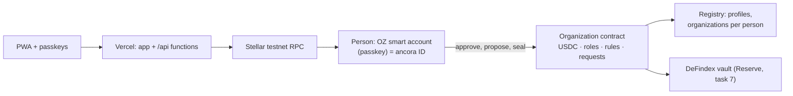

<p align="center">
  <picture>
    <source media="(prefers-color-scheme: dark)" srcset="app/public/brand/lockup-dark.svg" />
    
  </picture>
</p>

<p align="center">
  A finance account for any organization that feels like a modern banking app and runs on Stellar in the background.<br/>
  Organizations set their own rules; the account enforces them.
</p>

<p align="center">
  <strong>Live demo:</strong> <a href="https://ancora-gray.vercel.app">ancora-gray.vercel.app</a> · <strong>Demo video:</strong> <em>coming soon</em> · Built for HackMeridian 2026, Lisbon
</p>

> ancora is not a bank. Balances are not deposit-insured. This project runs on the Stellar **testnet** only.

## Problem

Organizations want to use stablecoins, but no treasurer puts company money in an account that's lost with a seed phrase, earns nothing, and could be cracked by a quantum computer in ten years.

## Solution

One passkey per person, one contract per organization:

- **You are your passkey**: it creates your own account on Stellar (an OpenZeppelin smart account); its address is your *ancora ID*, which holds any number of positions in any number of organizations. Face ID or a fingerprint signs; fees are sponsored, nobody touches XLM.
- **Each organization is its own contract** that holds the money and **enforces the approval rules itself**: tiers per amount, four-eyes, objection windows, extra approval for new recipients. The rules are one readable document whose fingerprint the contract stores, so anyone can verify them.
- **Several stablecoins per organization**: an organization accepts any set of Stellar stablecoins (BlendUSDC and Circle's USDC on testnet; EURC and others by configuration), each with its own balance and payments; adding or dropping one is a governance change. The rules are written in one home currency; a payment in another currency takes the strictest tier until a live rate is connected.
- **Reserve**: idle money earns variable earnings in a DeFindex vault, with auto-sweep.
- **Security seal**: large payments need a quantum-safe ML-DSA signature.
- **Crew and agent keys** with hard spending limits.
- **Euro and dollar in and out** through a licensed ramp partner.

## Features

| Module | What it does | Status |
|--------|--------------|--------|
| App shell | Installable PWA, desktop sidebar + mobile tabs, light/dark, org switcher, cross-org inbox | Real |
| App screens | Overview, Inbox, Approvals, Send money with live rule preview, Rules, Organization settings, New organization | Real; runs on sample data or the Stellar testnet (switch on your pass) |
| Identity ("your pass") | Passkey sign-in/sign-out, on-chain profile (name, picture), ancora ID with QR code, your positions, recovery status, device preferences | **Real on testnet** (sample mode uses "Viewing as") |
| Approval rules | Tiered approvals, four-eyes, objection window, seal threshold, membership and rule requests, setup phase, lock-out guard | **Real on testnet**: enforced by the organization contract (Rust, tested against the same vectors as the TypeScript engine); policy-document hash verified on the Rules page |
| Organizations on Stellar | Each organization is an `ancora_organization` contract with OZ AccessControl roles; people are invited by ancora ID; payments leave the contract once its rules are satisfied; fees sponsored by ancora's relayer | **Real on testnet** |
| Multi-asset treasury | Balances per accepted stablecoin, payments in each, test money per asset, accept/drop assets through governance, home currency for the rules with the strictest tier for other currencies | **Real on testnet** (BlendUSDC + Circle USDC; sample data shows EURC + USDC) |
| Reserve on DeFindex | Variable earnings on idle funds, one-tap moves | **Simulated** in the UI; DeFindex vault: task 7 |
| Security seal (ML-DSA) | Quantum-safe approval above a threshold | Roadmap (task 8) |
| Crew / agent keys | Per-key spending limits | Roadmap (task 9) |
| Euro in/out | Account number card (IBAN); SEP-24 test anchor; Bridge | **Simulated** IBAN card; real ramps: task 10 |
| Confidential payments | Hidden amounts with auditor view | Roadmap (task 14) |
| Demo admin | `/admin` (passphrase): site-wide demo mode with automatic fallback, health panel (RPC, testnet rent, contracts, operator floats), recent errors, sample reset | Real (operator tool, testnet only) |

The full plan is in [docs/ROADMAP.md](docs/ROADMAP.md).

## Architecture



A person signs with their passkey through their own account; the organization contract checks its own rules and moves the money. Details: [docs/ARCHITECTURE.md](docs/ARCHITECTURE.md) · Decisions: [docs/DECISIONS.md](docs/DECISIONS.md)

<!-- TODO before submission: a short GIF of sign-in → create organization → invite → approve → payment, and screenshots of the pass and the Rules page. -->

## Testnet contracts

Verified and written to `app/.env.testnet` by `scripts/setup-testnet.sh`, which also builds, uploads and deploys ancora's own contracts from `contracts/`.

| What | Contract | Source |
|------|----------|--------|
| ancora registry (profiles, organizations per person) | [`CDPQV7…4QCM`](https://stellar.expert/explorer/testnet/contract/CDPQV7C2XRWVDGWBIEHNE6IOMC56KSAITMESJBI7BULJSIGSVAQD4QCM) | `contracts/registry` |
| ancora organization (one instance per organization) | WASM `30e92427…5db0`, deployed by the operator on "Create organization" | `contracts/organization` |
| USDC (BlendUSDC, SAC of `USDC:GATALT…`) | [`CAQCFV…RCJU`](https://stellar.expert/explorer/testnet/contract/CAQCFVLOBK5GIULPNZRGATJJMIZL5BSP7X5YJVMGCPTUEPFM4AVSRCJU) | Blend testnet |
| USDC (Circle testnet, SAC of `USDC:GBBD47…`) | [`CBIELT…DAMA`](https://stellar.expert/explorer/testnet/contract/CBIELTK6YBZJU5UP2WWQEUCYKLPU6AUNZ2BQ4WWFEIE3USCIHMXQDAMA) | Circle (faucet.circle.com) |
| Reserve: DeFindex USDC vault | [`CBMVK2…DWHN`](https://stellar.expert/explorer/testnet/contract/CBMVK2JK6NTOT2O4HNQAIQFJY232BHKGLIMXDVQVHIIZKDACXDFZDWHN) | paltalabs/defindex `testnet.contracts.json` |
| DeFindex USDC Blend strategy | [`CALLOM…FSUY`](https://stellar.expert/explorer/testnet/contract/CALLOM5I7XLQPPOPQMYAHUWW4N7O3JKT42KQ4ASEEVBXDJQNJOALFSUY) | paltalabs/defindex |
| Passkey (WebAuthn) verifier | [`CC7EKI…OM3F`](https://stellar.expert/explorer/testnet/contract/CC7EKIHQP3TN4CARQDND6CEOY2UXLWWC2X5GHTD5NLAT7BG5GPZIOM3F) | stellar/smart-account-kit v0.8.0 |
| Ed25519 verifier | [`CAAVTM…HKN4`](https://stellar.expert/explorer/testnet/contract/CAAVTMCBXEIBPR64EAASKFXERVPYFZA2JYP5A3BG6PESWEFUJX5IHKN4) | smart-account-kit |
| Threshold policy | [`CB3FAT…BCEG`](https://stellar.expert/explorer/testnet/contract/CB3FATQKCIRIQOCYRUPCQ2KREQ7T4RPKS7EAEOZWPEPUKWEDRVROBCEG) | smart-account-kit |
| Spending-limit policy | [`CABXBY…IP5G`](https://stellar.expert/explorer/testnet/contract/CABXBYJNZ7IUW4G3D6BND5YCAQF3ASSDMDAOKQQ63UYFSO7WUU2TIP5G) | smart-account-kit |
| Demo operator account (not a signer on any org) | [`GC2BKJ…YJE3`](https://stellar.expert/explorer/testnet/account/GC2BKJOG56UXZQKMV475BNHMEHUA54GPGY6W2FILRB4DHCOJFJXOYJE3) | `ancora-deployer` key |

In the app: your pass → Expert mode, then Organization settings → *Testnet deployments* lists the same IDs with explorer links; each organization's own contract is on its settings page.

## Run locally

```bash
cd app
pnpm install
pnpm dev          # http://localhost:5173
pnpm verify       # format/lint, typecheck, tests, build: same as CI
```

Requirements: Node 24, pnpm 10. Contracts: Rust 1.91 with the `wasm32v1-none` target and the [Stellar CLI](https://developers.stellar.org/docs/tools/cli/install-cli) 28.x.

### Testnet setup

```bash
scripts/setup-testnet.sh          # create/fund the deployer, top up the BlendUSDC float, verify contracts, write app/.env.testnet
scripts/setup-testnet.sh --check  # verify only; exits 1 if something is off (e.g. after a testnet reset)
```

The script is idempotent: the testnet is reset now and then, so it re-funds the deployer with Friendbot and re-claims BlendUSDC from Blend's testnet faucet when needed. Secret keys stay in the Stellar CLI keystore; `app/.env.testnet` only holds public IDs and is committed so Vercel builds use the same deployments.

## Deploy

A single Vercel project, Root Directory `app`, deploys production from `main` through the Git integration. `app/vercel.json` rewrites every non-API path to the SPA so that deep links work. Environment variables are documented in `app/.env.example`; `scripts/setup-testnet.sh --sync-vercel` pushes the server-side ones (network, allowed origins, the operator key as a Sensitive variable).

Vercel Functions in `app/api/`: `/api/relay` sponsors fees for smart-account-kit submissions after fail-closed validation (allowlisted deployments and functions, `execute` only towards ancora contracts, exact authorization matching, fee cap); `/api/create-organization` deploys an organization contract for a founder and registers it; `/api/execute-request` triggers a due request; `/api/test-money` sends 100 test USDC from the operator to an organization; `/api/upload-avatar` stores a profile picture in Vercel Blob. The operator key holds no role in any organization and is never a signer on any account.

Production domain: `ancora-gray.vercel.app`. Passkeys are bound to it: the WebAuthn RP ID is `ancora-gray.vercel.app`, so passkeys created on preview URLs or localhost will not work in production.

## Demo admin

`/admin` is an operator tool for the hackathon demo, not an end-user feature. It is gated by the `ADMIN_PASSPHRASE` environment variable (`scripts/setup-testnet.sh --sync-vercel` generates one and saves it to `app/.env.local`, gitignored). It can:

- switch the **site-wide default** between sample data and the Stellar testnet. The testnet falls back to sample data automatically when the Stellar RPC or ancora's own server doesn't answer; the banner says so and offers a retry. People can still choose a source themselves on their pass;
- show **health**: RPC (ledger, protocol, latency), testnet rent (live state vs. target, current stroops/KB), whether every contract ID this build uses exists, the operator's XLM and USDC floats, relayer origins;
- list **recent errors** recorded in that browser, and reset the **sample data** in that browser.

It uses the demo operator key, which is **not a signer on any organization account**: it cannot move organization funds or change organization rules. Reset, top-up and retry tools for testnet organizations arrive with task 13.

## Limitations

- Testnet only, so nothing here holds real money.
- The app runs on the **Stellar testnet by default** (dark blue banner). Sample data (purple banner, everything labeled **Simulated**) is the automatic backup when the testnet or ancora's server doesn't answer, and can be chosen on your pass → Data source. Sample state and device preferences stay in your browser; everything on testnet is on-chain.
- Use **https://ancora-gray.vercel.app**. Passkeys are bound to that hostname; the project's other Vercel URLs redirect there.
- On testnet, each organization's rules are enforced by its own contract. Template switching and the organization logo are not on-chain yet (logo: this browser only); the Reserve is simulated until task 7.
- Your passkey is the only key to your account for now: there is no recovery device or guardian yet (Lifeline, tasks 17–18 in the roadmap). The profile page says so.
- Profile pictures are public files in Vercel Blob (content-addressed, max 300 KB); the URL is on-chain in your profile.
- Paying a classic Stellar address (G…) works only if that account holds a trustline for the exact asset being sent (testnet has several assets called USDC: Blend's and Circle's are different issuers and don't mix). The app checks this before it requests the payment and names the asset to add. Organization addresses (C…) never need one.
- Test money in Circle's USDC comes from a float the operator fills by hand at faucet.circle.com (captcha-gated), so grants shrink when it runs low; BlendUSDC is refilled automatically by the setup script.
- Payments in an asset whose currency differs from the organization's rules (e.g. EURC in a USD organization) take the strictest tier and the seal; a live FX rate (Reflector oracle) is on the roadmap.
- **Testnet fees are unusually high right now.** Measured on 25 Oct 2026: deploying an account 22 XLM, first deposit into it 22 XLM, a passkey-signed payment 46 XLM. Testnet's Soroban state is above its rent target, which puts rent at 2,271,304 stroops/KB versus 1,000 on mainnet, and the OpenZeppelin smart account extends its storage TTL to 30 days on every use. The relayer sponsors these fees from a Friendbot-funded operator key; the same operations cost well under 1 XLM at today's mainnet rent. Details in [docs/DECISIONS.md](docs/DECISIONS.md).
- In sample mode, "Viewing as" (on your pass) switches the person the app acts as, so one device can show both sides of a four-eyes approval. On testnet, sign out and sign in with another passkey, or use a second device.

## License

To be decided.
