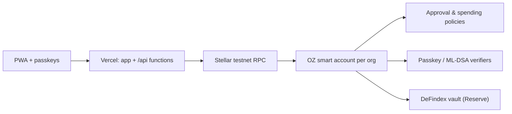

<p align="center">
  
</p>

<h1 align="center">ancora</h1>

<p align="center">
  A finance account for any organization that feels like a modern banking app and runs on Stellar in the background.<br/>
  Organizations set their own rules; the account enforces them.
</p>

<p align="center">
  <strong>Live demo:</strong> <a href="https://ancora-gray.vercel.app">ancora-gray.vercel.app</a> · <strong>Demo video:</strong> <em>coming soon</em> · Built for HackMeridian 2026, Lisbon
</p>

> ancora is not a bank. Balances are not deposit-insured. This project runs on the Stellar **testnet** only.

## Problem

Organizations want to use stablecoins, but no treasurer puts company money in an account that's lost with a seed phrase, earns nothing, and could be cracked by a quantum computer in ten years.

## Solution

One OpenZeppelin smart account per organization, with everything else as a module on it:

- **Passkeys instead of seed phrases**: Face ID or a fingerprint; fees are sponsored, nobody touches XLM.
- **Approval rules enforced on-chain**: tiers per amount, four-eyes, objection windows, extra approval for new recipients.
- **Reserve**: idle money earns variable earnings in a DeFindex vault, with auto-sweep.
- **Security seal**: large payments need a quantum-safe ML-DSA signature.
- **Crew and agent keys** with hard spending limits.
- **Euro and dollar in and out** through a licensed ramp partner.

## Features

| Module | What it does | Status |
|--------|--------------|--------|
| App shell | Installable PWA, desktop sidebar + mobile tabs, light/dark | Real |
| Approval rules | Tiered approvals, four-eyes, objection window, seal threshold | Roadmap (task 1) |
| Passkey smart accounts | WebAuthn signers, sponsored fees | Roadmap (task 4) |
| Reserve on DeFindex | Variable earnings on idle funds | Roadmap (task 7) |
| Security seal (ML-DSA) | Quantum-safe approval above a threshold | Roadmap (task 8) |
| Crew / agent keys | Per-key spending limits | Roadmap (task 9) |
| Euro in/out | SEP-24 test anchor; Bridge IBAN simulated | Roadmap (task 10) |
| Confidential payments | Hidden amounts with auditor view | Roadmap (task 14) |

The full plan is in [docs/ROADMAP.md](docs/ROADMAP.md).

## Architecture



Details: [docs/ARCHITECTURE.md](docs/ARCHITECTURE.md) · Decisions: [docs/DECISIONS.md](docs/DECISIONS.md)

## Testnet contracts

None yet; they are added with task 3.

## Run locally

```bash
cd app
pnpm install
pnpm dev          # http://localhost:5173
pnpm verify       # format/lint, typecheck, tests, build: same as CI
```

Requirements: Node 24, pnpm 10. Contracts (from task 3 on): Rust 1.90 with the `wasm32v1-none` target and the Stellar CLI.

## Deploy

A single Vercel project, Root Directory `app`, deploys production from `main` through the Git integration. `app/vercel.json` rewrites every non-API path to the SPA so that deep links work. Environment variables are documented in `app/.env.example`.

Production domain: `ancora-gray.vercel.app`. Passkeys are bound to it: the WebAuthn RP ID is `ancora-gray.vercel.app`, so passkeys created on preview URLs or localhost will not work in production.

## Limitations

- Testnet only, so nothing here holds real money.
- Anything labeled **Simulated** in the app uses sample data and is labeled the same way here.

## License

To be decided.
