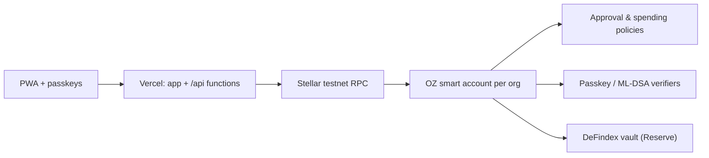

<p align="center">
  <picture>
    <source media="(prefers-color-scheme: dark)" srcset="app/public/brand/lockup-dark.svg" />
    
  </picture>
</p>

<p align="center">
  A finance account for any organization that feels like a modern banking app and runs on Stellar in the background.<br/>
  Organizations set their own rules; the account enforces them.
</p>

<p align="center">
  <strong>Live demo:</strong> <a href="https://ancora-gray.vercel.app">ancora-gray.vercel.app</a> · <strong>Demo video:</strong> <em>coming soon</em> · Built for HackMeridian 2026, Lisbon
</p>

> ancora is not a bank. Balances are not deposit-insured. This project runs on the Stellar **testnet** only.

## Problem

Organizations want to use stablecoins, but no treasurer puts company money in an account that's lost with a seed phrase, earns nothing, and could be cracked by a quantum computer in ten years.

## Solution

One OpenZeppelin smart account per organization, with everything else as a module on it:

- **Passkeys instead of seed phrases**: Face ID or a fingerprint; fees are sponsored, nobody touches XLM.
- **Approval rules enforced on-chain**: tiers per amount, four-eyes, objection windows, extra approval for new recipients.
- **Reserve**: idle money earns variable earnings in a DeFindex vault, with auto-sweep.
- **Security seal**: large payments need a quantum-safe ML-DSA signature.
- **Crew and agent keys** with hard spending limits.
- **Euro and dollar in and out** through a licensed ramp partner.

## Features

| Module | What it does | Status |
|--------|--------------|--------|
| App shell | Installable PWA, desktop sidebar + mobile tabs, light/dark, org switcher, cross-org inbox | Real |
| App screens | Overview, Inbox, Approvals, Send money with live rule preview, Rules, Settings, New organization | Real; runs on sample data or the Stellar testnet (switch in Settings) |
| Passkey prompts | Face ID / fingerprint / device PIN | **Real on testnet** (simulated in sample mode) |
| Approval rules | Tiered approvals, four-eyes, objection window, seal threshold, membership requests | Engine done (TypeScript, tested against shared vectors); on-chain: task 6 |
| Passkey smart accounts | Each organization is an OpenZeppelin smart account with a passkey signer; fees sponsored by ancora's relayer; USDC payments signed with the passkey | **Real on testnet** |
| Reserve on DeFindex | Variable earnings on idle funds, one-tap moves | **Simulated** in the UI; DeFindex vault: task 7 |
| Security seal (ML-DSA) | Quantum-safe approval above a threshold | Roadmap (task 8) |
| Crew / agent keys | Per-key spending limits | Roadmap (task 9) |
| Euro in/out | Account number card (IBAN); SEP-24 test anchor; Bridge | **Simulated** IBAN card; real ramps: task 10 |
| Confidential payments | Hidden amounts with auditor view | Roadmap (task 14) |
| Demo admin | `/admin` (passphrase): site-wide demo mode with automatic fallback, health panel (RPC, testnet rent, contracts, operator floats), recent errors, sample reset | Real (operator tool, testnet only) |

The full plan is in [docs/ROADMAP.md](docs/ROADMAP.md).

## Architecture



Details: [docs/ARCHITECTURE.md](docs/ARCHITECTURE.md) · Decisions: [docs/DECISIONS.md](docs/DECISIONS.md)

## Testnet contracts

Verified and written to `app/.env.testnet` by `scripts/setup-testnet.sh`. ancora's own contracts are added here as they land (tasks 6–11).

| What | Contract | Source |
|------|----------|--------|
| USDC (BlendUSDC, SAC of `USDC:GATALT…`) | [`CAQCFV…RCJU`](https://stellar.expert/explorer/testnet/contract/CAQCFVLOBK5GIULPNZRGATJJMIZL5BSP7X5YJVMGCPTUEPFM4AVSRCJU) | Blend testnet |
| Reserve: DeFindex USDC vault | [`CBMVK2…DWHN`](https://stellar.expert/explorer/testnet/contract/CBMVK2JK6NTOT2O4HNQAIQFJY232BHKGLIMXDVQVHIIZKDACXDFZDWHN) | paltalabs/defindex `testnet.contracts.json` |
| DeFindex USDC Blend strategy | [`CALLOM…FSUY`](https://stellar.expert/explorer/testnet/contract/CALLOM5I7XLQPPOPQMYAHUWW4N7O3JKT42KQ4ASEEVBXDJQNJOALFSUY) | paltalabs/defindex |
| Passkey (WebAuthn) verifier | [`CC7EKI…OM3F`](https://stellar.expert/explorer/testnet/contract/CC7EKIHQP3TN4CARQDND6CEOY2UXLWWC2X5GHTD5NLAT7BG5GPZIOM3F) | stellar/smart-account-kit v0.8.0 |
| Ed25519 verifier | [`CAAVTM…HKN4`](https://stellar.expert/explorer/testnet/contract/CAAVTMCBXEIBPR64EAASKFXERVPYFZA2JYP5A3BG6PESWEFUJX5IHKN4) | smart-account-kit |
| Threshold policy | [`CB3FAT…BCEG`](https://stellar.expert/explorer/testnet/contract/CB3FATQKCIRIQOCYRUPCQ2KREQ7T4RPKS7EAEOZWPEPUKWEDRVROBCEG) | smart-account-kit |
| Spending-limit policy | [`CABXBY…IP5G`](https://stellar.expert/explorer/testnet/contract/CABXBYJNZ7IUW4G3D6BND5YCAQF3ASSDMDAOKQQ63UYFSO7WUU2TIP5G) | smart-account-kit |
| Demo operator account (not a signer on any org) | [`GC2BKJ…YJE3`](https://stellar.expert/explorer/testnet/account/GC2BKJOG56UXZQKMV475BNHMEHUA54GPGY6W2FILRB4DHCOJFJXOYJE3) | `ancora-deployer` key |

In the app: Settings → Expert mode → *Testnet deployments* lists the same IDs with explorer links.

## Run locally

```bash
cd app
pnpm install
pnpm dev          # http://localhost:5173
pnpm verify       # format/lint, typecheck, tests, build: same as CI
```

Requirements: Node 24, pnpm 10. Contracts: Rust 1.90 with the `wasm32v1-none` target and the [Stellar CLI](https://developers.stellar.org/docs/tools/cli/install-cli) 28.x.

### Testnet setup

```bash
scripts/setup-testnet.sh          # create/fund the deployer, top up the BlendUSDC float, verify contracts, write app/.env.testnet
scripts/setup-testnet.sh --check  # verify only; exits 1 if something is off (e.g. after a testnet reset)
```

The script is idempotent: the testnet is reset now and then, so it re-funds the deployer with Friendbot and re-claims BlendUSDC from Blend's testnet faucet when needed. Secret keys stay in the Stellar CLI keystore; `app/.env.testnet` only holds public IDs and is committed so Vercel builds use the same deployments.

## Deploy

A single Vercel project, Root Directory `app`, deploys production from `main` through the Git integration. `app/vercel.json` rewrites every non-API path to the SPA so that deep links work. Environment variables are documented in `app/.env.example`; `scripts/setup-testnet.sh --sync-vercel` pushes the server-side ones (network, allowed origins, the operator key as a Sensitive variable).

Vercel Functions in `app/api/`: `/api/relay` sponsors fees for smart-account-kit submissions after fail-closed validation (allowlisted deployments, transfers and account calls, exact authorization matching, fee cap); `/api/test-money` sends 100 test USDC from the operator to an ancora smart account. The operator key is never a signer on any organization account.

Production domain: `ancora-gray.vercel.app`. Passkeys are bound to it: the WebAuthn RP ID is `ancora-gray.vercel.app`, so passkeys created on preview URLs or localhost will not work in production.

## Demo admin

`/admin` is an operator tool for the hackathon demo, not an end-user feature. It is gated by the `ADMIN_PASSPHRASE` environment variable (`scripts/setup-testnet.sh --sync-vercel` generates one and saves it to `app/.env.local`, gitignored). It can:

- switch the **site-wide default** between sample data and the Stellar testnet. The testnet falls back to sample data automatically when the Stellar RPC or ancora's own server doesn't answer; the banner says so and offers a retry. People can still choose a source themselves in Settings;
- show **health**: RPC (ledger, protocol, latency), testnet rent (live state vs. target, current stroops/KB), whether every contract ID this build uses exists, the operator's XLM and USDC floats, relayer origins;
- list **recent errors** recorded in that browser, and reset the **sample data** in that browser.

It uses the demo operator key, which is **not a signer on any organization account**: it cannot move organization funds or change organization rules. Reset, top-up and retry tools for testnet organizations arrive with task 13.

## Limitations

- Testnet only, so nothing here holds real money.
- The app runs on the **Stellar testnet by default** (dark blue banner). Sample data (purple banner, everything labeled **Simulated**) is the automatic backup when the testnet or ancora's server doesn't answer, and can be chosen in Settings → Data source. Both keep their state in your browser.
- Use **https://ancora-gray.vercel.app**. Passkeys are bound to that hostname; the project's other Vercel URLs redirect there.
- On testnet, the **approval rules still run in the app** and approvals are recorded there; the smart account enforces its passkey signers on-chain, and a signer signs each outgoing payment. Moving the rules on-chain is task 6.
- **Testnet fees are unusually high right now.** Measured on 25 Oct 2026: deploying an account 22 XLM, first deposit into it 22 XLM, a passkey-signed payment 46 XLM. Testnet's Soroban state is above its rent target, which puts rent at 2,271,304 stroops/KB versus 1,000 on mainnet, and the OpenZeppelin smart account extends its storage TTL to 30 days on every use. The relayer sponsors these fees from a Friendbot-funded operator key; the same operations cost well under 1 XLM at today's mainnet rent. Details in [docs/DECISIONS.md](docs/DECISIONS.md).
- "Viewing as" (Settings) switches the person the app acts as, so one device can show both sides of a four-eyes approval. Signing always uses the passkeys on that device.

## License

To be decided.
