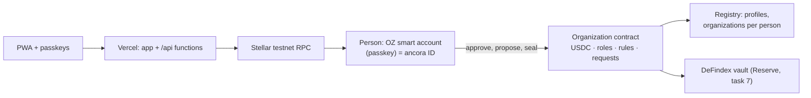
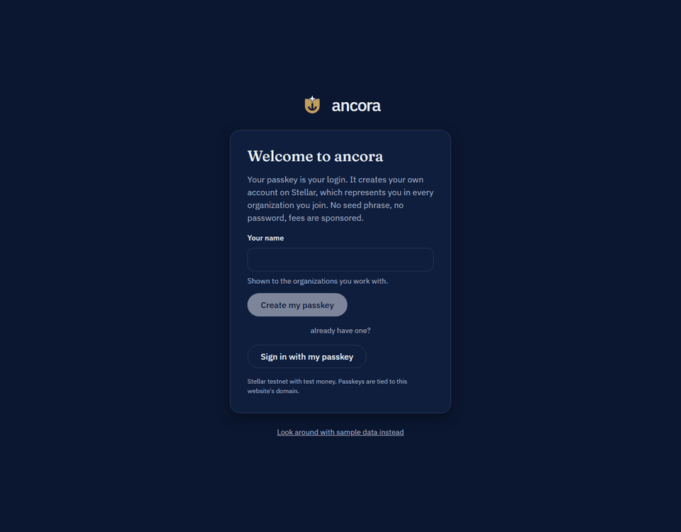
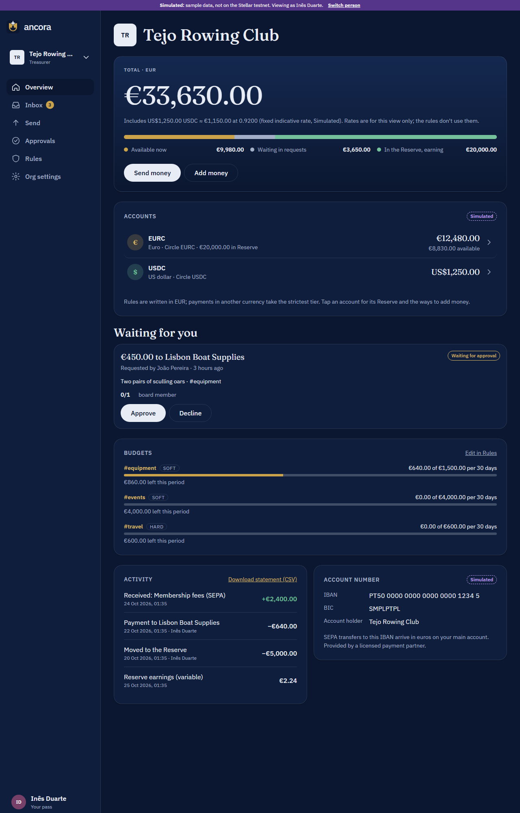
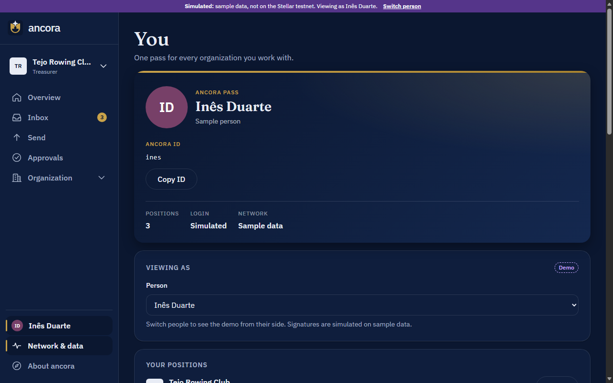
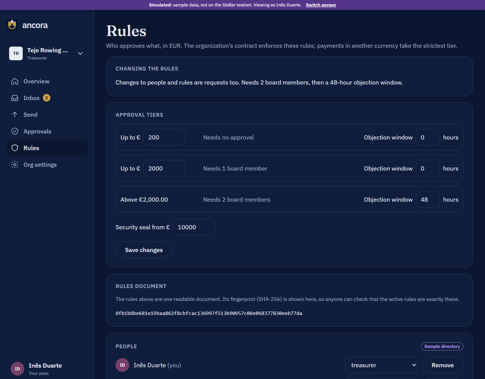
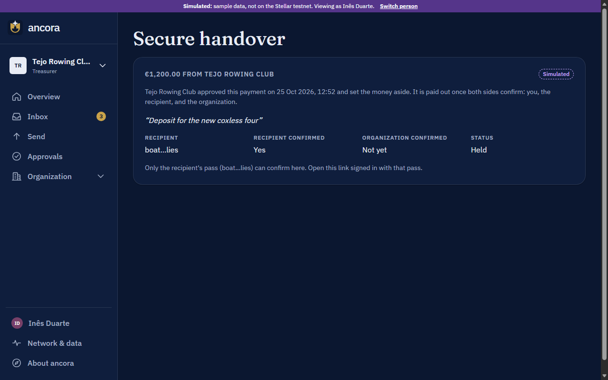
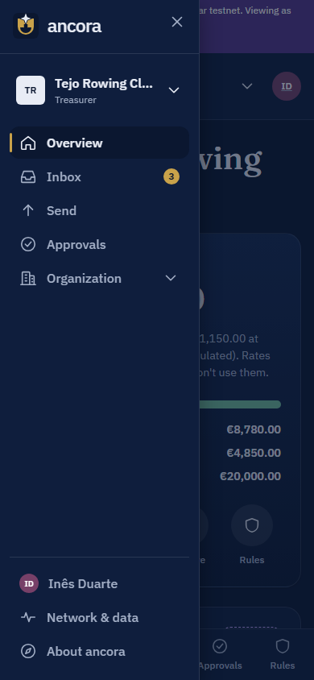

<p align="center">
  <picture>
    <source media="(prefers-color-scheme: dark)" srcset="app/public/brand/lockup-dark.svg" />
    
  </picture>
</p>

<p align="center">
  A finance account for any organization that feels like a modern banking app and runs on Stellar in the background.<br/>
  Organizations set their own rules; the account enforces them.
</p>

<p align="center">
  <strong>Live demo:</strong> <a href="https://ancora-gray.vercel.app">ancora-gray.vercel.app</a> · <strong>Demo video:</strong> <em>coming soon</em> · Built for HackMeridian 2026, Lisbon
</p>

> ancora is not a bank. Balances are not deposit-insured. This project runs on the Stellar **testnet** only.

## Problem

Organizations want to use stablecoins, but no treasurer puts company money in an account that's lost with a seed phrase, earns nothing, and could be cracked by a quantum computer in ten years.

## Solution

One passkey per person, one contract per organization:

- **You are your passkey**: it creates your own account on Stellar (an OpenZeppelin smart account); its address is your *ancora ID*, which holds any number of positions in any number of organizations. Face ID or a fingerprint signs; fees are sponsored, nobody touches XLM.
- **Each organization is its own contract** that holds the money and **enforces the approval rules itself**: tiers per amount, four-eyes, objection windows, extra approval for new recipients. The rules are one readable document whose fingerprint the contract stores, so anyone can verify them.
- **Several stablecoins per organization**: an organization accepts any set of Stellar stablecoins (BlendUSDC, Circle's USDC and Circle's EURC on testnet; others by configuration), each with its own balance and payments; adding or dropping one is a governance change. The rules are written in one home currency; a payment in another currency takes the strictest tier until a live rate is connected.
- **Reserve**: idle money earns variable earnings in a DeFindex vault (Blend lending on testnet); moving it in or out needs no approval because it never leaves the organization.
- **Security seal**: large payments need a quantum-safe signature; ancora's own ML-DSA-44 (FIPS 204) verifier runs on Stellar, ready for the day today's signatures can be forged.
- **Crew and agent keys** with hard spending limits: routine buys go out alone, anything bigger follows the rules.
- **Euro and dollar in and out** through Stellar anchors (SEP-24): the anchor's form, your wallet's signature, no bank details in ancora.

## Features

| Module | What it does | Status |
|--------|--------------|--------|
| App shell | Installable PWA, desktop sidebar + mobile tabs, light/dark, org switcher, cross-org inbox | Real |
| App screens | Overview, Inbox, Approvals, Send money with live rule preview, Rules, Organization settings, New organization | Real; runs on sample data or the Stellar testnet (switch on your pass) |
| Identity ("your pass") | Passkey sign-in/sign-out, on-chain profile (name, picture), ancora ID with QR code, your positions, recovery status, device preferences | **Real on testnet** (sample mode uses "Viewing as") |
| Approval rules | Tiered approvals, four-eyes, objection window, seal threshold, membership and rule requests, setup phase, lock-out guard | **Real on testnet**: enforced by the organization contract (Rust, tested against the same vectors as the TypeScript engine); policy-document hash verified on the Rules page |
| Organizations on Stellar | Each organization is an `ancora_organization` contract with OZ AccessControl roles; people are invited by ancora ID; payments leave the contract once its rules are satisfied; fees sponsored by ancora's relayer | **Real on testnet** |
| Add money from your wallet | Connect Freighter, Hana, xBull or Albedo (Stellar Wallets Kit); ancora builds the token transfer to the organization's contract and the wallet signs it; test money per asset; the organization's address for wallets that can pay contracts | **Real on testnet** |
| Multi-asset treasury | Balances per accepted stablecoin, payments in each, test money per asset, home currency (EUR or USD) for the rules with the strictest tier for other currencies. Accept any Stellar asset from the Rules page by contract address or CODE:ISSUER: the token describes itself, the organization's contract verifies it when the governance change is applied, an optional DeFindex vault gives it a Reserve | **Real on testnet** (BlendUSDC, Circle USDC, Circle EURC preset; any SEP-41 token by reference) |
| Reserve on DeFindex | Per-asset Reserve in a DeFindex vault: one-tap moves by the top role or any strictest-tier approver, value and earnings read from the vault | **Real on testnet** for BlendUSDC (the DeFindex testnet vault); **Simulated** in sample data; other assets get a Reserve once a vault exists |
| Security seal (ML-DSA) | Payments above the seal threshold need an extra seal; ancora's `ancora_seal_verifier` contract checks ML-DSA-44 (FIPS 204) signatures on Stellar, interoperable with `@noble/post-quantum` | **Verifier real on testnet** (tested on-chain with a shared vector); the seal step in the app is signed by an approver's passkey until the ML-DSA key lives on the approving device (roadmap) |
| Crew / agent keys | A spending limit per member (amount per day, week or 30 days in the rules' currency): payments inside it go out without approvals, beyond it the normal rules apply; an agent is simply a member whose key has a limit | **Real on testnet** (organization contract) |
| Bank in/out (SEP-24) | Deposits and withdrawals through a Stellar anchor: the wallet signs in (SEP-10), the anchor's own form takes the bank details, deposits land in the wallet and move on to the organization, a withdrawal becomes a payment request to the anchor with its reference | **Real on testnet** with the SDF test anchor (test USDC, no real money; protocol verified end-to-end, the hosted form was not clicked through in a browser yet, and the anchor's payout after the organization pays is untested); euro IBAN card in sample data **Simulated** |
| Budgets and bookkeeping | Budgets are rules: an envelope per category and rolling period in the home currency, enforced by the organization contract. A payment tagged with a category counts against it; beyond what is left a soft budget escalates to the strictest tier and flags the request, a hard budget refuses it. Edited on the Rules page like any rule change (covered by the rules document hash); statement export as CSV | **Real on testnet** (organization contract; sample data mirrors it) |
| Money view | Headline total in the home currency including other assets at an indicative ECB reference rate (display only, never used by the rules), with an allocation bar: available, waiting in requests, in the Reserve | **Real** (rates via Frankfurter; a fixed **Simulated** rate when no service answers) |
| Lifeline recovery | Guardians (other ancora passes), a threshold and a waiting period per person; a guardian starts a claim for the new pass, others confirm, the old pass can cancel while it waits; afterwards every organization hands the person's position and spending limit to the new pass. Restores control, never money | **Real on testnet** (`ancora_recovery` contract; organizations created from 26 Oct hand over positions, older ones are listed as not recoverable); **Simulated** in sample data |
| Second passkey | Add another passkey to the same account from the pass page: a security key, this device, or another phone through the browser's QR flow; signed by the current passkey, fees sponsored. A reminder across the app nudges a pass with one passkey and no guardians (dismissible for a week) | **Real on testnet** (smart-account-kit `signers.addPasskey`; not yet clicked through with a hardware key) |
| Secure handover (escrow) | A payment can be marked as a secure handover: after approval the money is set aside in the organization's contract and paid out only once the recipient and the organization both confirm; the sender's side can cancel and free the money. The recipient confirms through a link, signed in with their own pass, without being a member | **Real on testnet** (organization contract; the recipient confirmation page is not yet clicked through with two passes); **Simulated** recipient confirmation in sample data |
| Confidential payments | Hidden amounts with auditor view | Roadmap (task 14) |
| Discussions on requests | Pro and contra reasons, questions (the requester marks them answered) and comments with thumbs up/down, one reaction per person, never on your own entry; summary on every request card | **Real** (off-chain in Vercel Blob, membership checked against the contract; entries aren't passkey-signed yet) |
| Demo admin | `/admin` (passphrase): site-wide demo mode with automatic fallback, health panel (RPC, testnet rent, contracts, operator floats), recent errors, sample reset | Real (operator tool, testnet only) |

The full plan is in [docs/ROADMAP.md](docs/ROADMAP.md).

## Architecture



A person signs with their passkey through their own account; the organization contract checks its own rules and moves the money. Details: [docs/ARCHITECTURE.md](docs/ARCHITECTURE.md) · Decisions: [docs/DECISIONS.md](docs/DECISIONS.md)

## A quick tour

<p align="center">
  
</p>

<p align="center">
  
  
  
  
  
</p>

Sample-data screens, labeled as such in the app; on the Stellar testnet the same screens read from the organization's contract.

## Testnet contracts

Verified and written to `app/.env.testnet` by `scripts/setup-testnet.sh`, which also builds, uploads and deploys ancora's own contracts from `contracts/`.

| What | Contract | Source |
|------|----------|--------|
| ancora registry (profiles, organizations per person) | [`CDPQV7…4QCM`](https://stellar.expert/explorer/testnet/contract/CDPQV7C2XRWVDGWBIEHNE6IOMC56KSAITMESJBI7BULJSIGSVAQD4QCM) | `contracts/registry` |
| ancora seal verifier (ML-DSA-44, OZ external-verifier interface) | [`CDUFVN…V4NS`](https://stellar.expert/explorer/testnet/contract/CDUFVNCHZE64O37RQZQQ6ZKYDLS3RZ6YKYJDD66XNEPYHVWW6OO6V4NS) | `contracts/seal_verifier` |
| ancora Lifeline recovery (guardians, claims, handover) | `CDO3YV5KMKPZTJLTLODIKNBYSTPJYLDKFKXOAGE52NJXF7FZMLACX2PE` | `contracts/recovery` |
| ancora organization (one instance per organization) | WASM `257fcce3…353b`, deployed by the operator on "Create organization" | `contracts/organization` |
| USDC (BlendUSDC, SAC of `USDC:GATALT…`) | [`CAQCFV…RCJU`](https://stellar.expert/explorer/testnet/contract/CAQCFVLOBK5GIULPNZRGATJJMIZL5BSP7X5YJVMGCPTUEPFM4AVSRCJU) | Blend testnet |
| EURC (Circle testnet, SAC of `EURC:GB3Q6Q…`) | [`CCUUDM…MCGZ`](https://stellar.expert/explorer/testnet/contract/CCUUDM434BMZMYWYDITHFXHDMIVTGGD6T2I5UKNX5BSLXLW7HVR4MCGZ) | Circle (faucet.circle.com) |
| USDC (Circle testnet, SAC of `USDC:GBBD47…`) | [`CBIELT…DAMA`](https://stellar.expert/explorer/testnet/contract/CBIELTK6YBZJU5UP2WWQEUCYKLPU6AUNZ2BQ4WWFEIE3USCIHMXQDAMA) | Circle (faucet.circle.com) |
| Reserve: DeFindex USDC vault | [`CBMVK2…DWHN`](https://stellar.expert/explorer/testnet/contract/CBMVK2JK6NTOT2O4HNQAIQFJY232BHKGLIMXDVQVHIIZKDACXDFZDWHN) | paltalabs/defindex `testnet.contracts.json` |
| DeFindex USDC Blend strategy | [`CALLOM…FSUY`](https://stellar.expert/explorer/testnet/contract/CALLOM5I7XLQPPOPQMYAHUWW4N7O3JKT42KQ4ASEEVBXDJQNJOALFSUY) | paltalabs/defindex |
| Passkey (WebAuthn) verifier | [`CC7EKI…OM3F`](https://stellar.expert/explorer/testnet/contract/CC7EKIHQP3TN4CARQDND6CEOY2UXLWWC2X5GHTD5NLAT7BG5GPZIOM3F) | stellar/smart-account-kit v0.8.0 |
| Ed25519 verifier | [`CAAVTM…HKN4`](https://stellar.expert/explorer/testnet/contract/CAAVTMCBXEIBPR64EAASKFXERVPYFZA2JYP5A3BG6PESWEFUJX5IHKN4) | smart-account-kit |
| Threshold policy | [`CB3FAT…BCEG`](https://stellar.expert/explorer/testnet/contract/CB3FATQKCIRIQOCYRUPCQ2KREQ7T4RPKS7EAEOZWPEPUKWEDRVROBCEG) | smart-account-kit |
| Spending-limit policy | [`CABXBY…IP5G`](https://stellar.expert/explorer/testnet/contract/CABXBYJNZ7IUW4G3D6BND5YCAQF3ASSDMDAOKQQ63UYFSO7WUU2TIP5G) | smart-account-kit |
| Demo operator account (not a signer on any org) | [`GC2BKJ…YJE3`](https://stellar.expert/explorer/testnet/account/GC2BKJOG56UXZQKMV475BNHMEHUA54GPGY6W2FILRB4DHCOJFJXOYJE3) | `ancora-deployer` key |

In the app: your pass → Expert mode, then Organization settings → *Testnet deployments* lists the same IDs with explorer links; each organization's own contract is on its settings page.

## Run locally

```bash
cd app
pnpm install
pnpm dev          # http://localhost:5173
pnpm verify       # format/lint, typecheck, tests, build: same as CI
```

Requirements: Node 24, pnpm 10. Contracts: Rust 1.91 with the `wasm32v1-none` target and the [Stellar CLI](https://developers.stellar.org/docs/tools/cli/install-cli) 28.x.

### Testnet setup

```bash
scripts/setup-testnet.sh          # create/fund the deployer, top up the BlendUSDC float, verify contracts, write app/.env.testnet
scripts/setup-testnet.sh --check  # verify only; exits 1 if something is off (e.g. after a testnet reset)
```

The script is idempotent: the testnet is reset now and then, so it re-funds the deployer with Friendbot and re-claims BlendUSDC from Blend's testnet faucet when needed. Secret keys stay in the Stellar CLI keystore; `app/.env.testnet` only holds public IDs and is committed so Vercel builds use the same deployments.

## Deploy

A single Vercel project, Root Directory `app`, deploys production from `main` through the Git integration. `app/vercel.json` rewrites every non-API path to the SPA so that deep links work. Environment variables are documented in `app/.env.example`; `scripts/setup-testnet.sh --sync-vercel` pushes the server-side ones (network, allowed origins, the operator key as a Sensitive variable).

Vercel Functions in `app/api/`: `/api/relay` sponsors fees for smart-account-kit submissions after fail-closed validation (allowlisted deployments and functions, `execute` only towards ancora contracts, exact authorization matching, fee cap); `/api/create-organization` deploys an organization contract for a founder and registers it; `/api/execute-request` triggers a due request; `/api/test-money` sends 100 test USDC from the operator to an organization; `/api/upload-image` stores profile pictures and logos in Vercel Blob. The operator key holds no role in any organization and is never a signer on any account.

Production domain: `ancora-gray.vercel.app`. Passkeys are bound to it: the WebAuthn RP ID is `ancora-gray.vercel.app`, so passkeys created on preview URLs or localhost will not work in production.

## Demo admin

`/admin` is an operator tool for the hackathon demo, not an end-user feature. It is gated by the `ADMIN_PASSPHRASE` environment variable (`scripts/setup-testnet.sh --sync-vercel` generates one and saves it to `app/.env.local`, gitignored). It can:

- switch the **site-wide default** between sample data and the Stellar testnet. The testnet falls back to sample data automatically when the Stellar RPC or ancora's own server doesn't answer; the banner says so and offers a retry. People can still choose a source themselves on their pass;
- show **health**: RPC (ledger, protocol, latency), testnet rent (live state vs. target, current stroops/KB), whether every contract ID this build uses exists, the operator's XLM and USDC floats, relayer origins;
- **top up the operator's XLM** from Friendbot (a throwaway account is funded and merged into the operator), so sponsored fees never run dry during a demo;
- list **recent errors** recorded in that browser, and reset the **sample data** in that browser.

It uses the demo operator key, which is **not a signer on any organization account**: it cannot move organization funds or change organization rules. A due request is sent by any member with "Send now"; the operator cannot create, approve or alter requests.

## Limitations

- Testnet only, so nothing here holds real money.
- The app runs on the **Stellar testnet by default** (dark blue banner). Sample data (purple banner, everything labeled **Simulated**) is the automatic backup when the testnet or ancora's server doesn't answer, and can be chosen on your pass → Data source. Sample state and device preferences stay in your browser; everything on testnet is on-chain.
- Use **https://ancora-gray.vercel.app**. Passkeys are bound to that hostname; the project's other Vercel URLs redirect there.
- On testnet, each organization's rules are enforced by its own contract. Template switching is not on-chain yet.
- Recovery: on your pass page you can name Lifeline guardians (they hand your positions to a new pass after a waiting period) and add a second passkey. Organizations created before 26 Oct 2026 can't hand over positions; the page lists them.
- A secure handover needs a recipient who can sign against the organization's contract with their own pass (another ancora user or organization member); the sender shares a link, there is no on-chain index of payees. Classic wallets can't confirm yet.
- Profile pictures and organization logos are public files in Vercel Blob (content-addressed, max 300 KB); the URL is on-chain (your profile in the registry, the logo on the organization contract).
- A plain Stellar payment from a wallet can't reach an organization, because organizations are contract addresses (C…). Use "Add money → From your wallet" in the app (Freighter, Hana, xBull, Albedo), or a wallet that can pay contract addresses directly (Freighter).
- Paying a classic Stellar address (G…) works only if that account holds a trustline for the exact asset being sent (testnet has several assets called USDC: Blend's and Circle's are different issuers and don't mix). The app checks this before it requests the payment and names the asset to add. Organization addresses (C…) never need one.
- Test money in Circle's USDC comes from a float the operator fills by hand at faucet.circle.com (captcha-gated), so grants shrink when it runs low; BlendUSDC is refilled automatically by the setup script.
- Payments in an asset whose currency differs from the organization's rules (e.g. EURC in a USD organization) take the strictest tier and the seal; a live FX rate (Reflector oracle) is on the roadmap.
- Discussion entries are stored off-chain (Vercel Blob) and checked against the organization's member list, but not yet signed with the author's passkey; signing them (SEP-53 style) is a roadmap item.
- The security seal is enforced by the organization contract, but today an eligible approver adds it with their passkey; the quantum-safe ML-DSA-44 verifier is deployed and tested on testnet, the device key and the account wiring come next (see ROADMAP).
- The Reserve exists for BlendUSDC only (the one DeFindex vault on testnet). Its "earned so far" figure is the vault value above what was moved in; the vault's own fees and Blend's variable rate decide it, and a Reserve move on testnet costs the operator a sponsored fee of tens of XLM (testnet rent, see above).
- **Testnet fees are unusually high right now.** Measured on 25 Oct 2026: deploying an account 22 XLM, first deposit into it 22 XLM, a passkey-signed payment 46 XLM. Testnet's Soroban state is above its rent target, which puts rent at 2,271,304 stroops/KB versus 1,000 on mainnet, and the OpenZeppelin smart account extends its storage TTL to 30 days on every use. The relayer sponsors these fees from a Friendbot-funded operator key; the same operations cost well under 1 XLM at today's mainnet rent. Details in [docs/DECISIONS.md](docs/DECISIONS.md).
- In sample mode, "Viewing as" (on your pass) switches the person the app acts as, so one device can show both sides of a four-eyes approval. On testnet, sign out and sign in with another passkey, or use a second device.

## License

To be decided.
