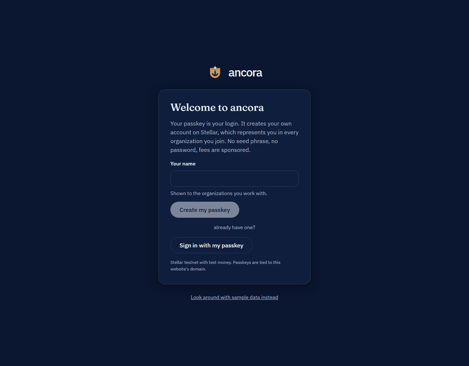
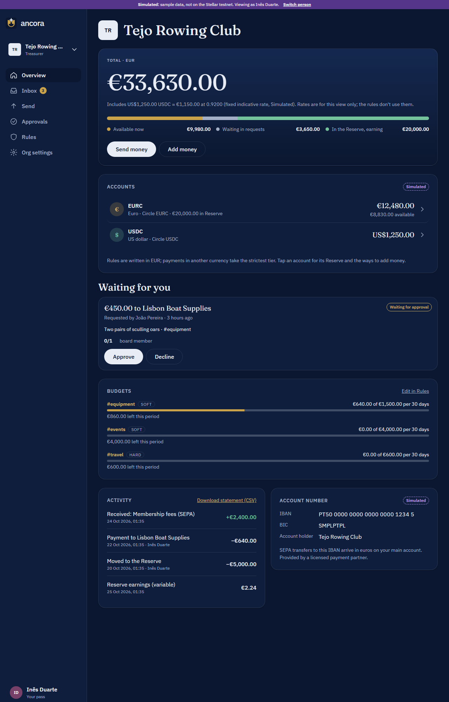
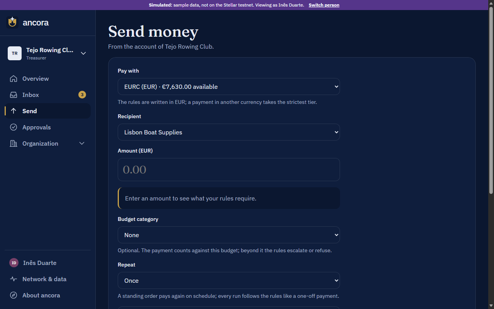
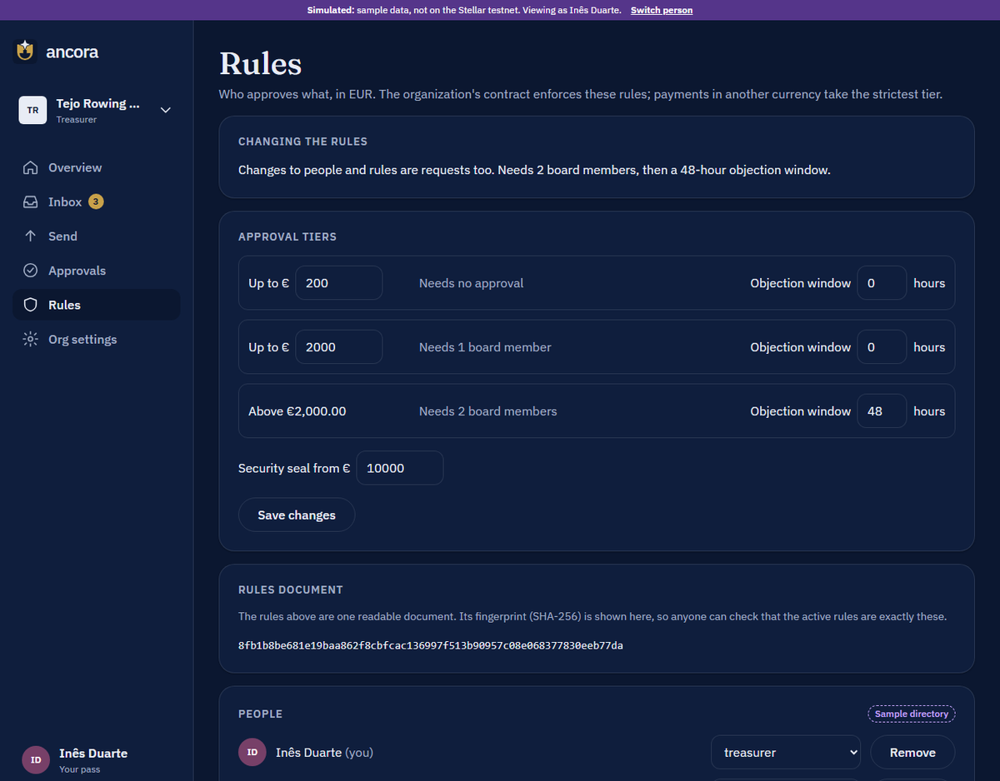
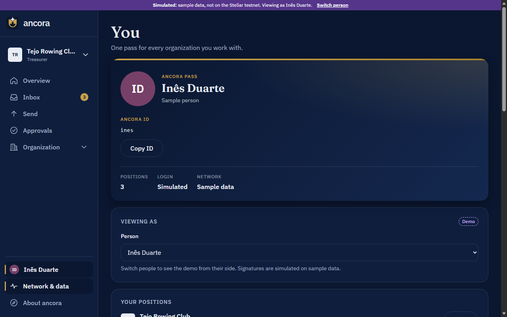
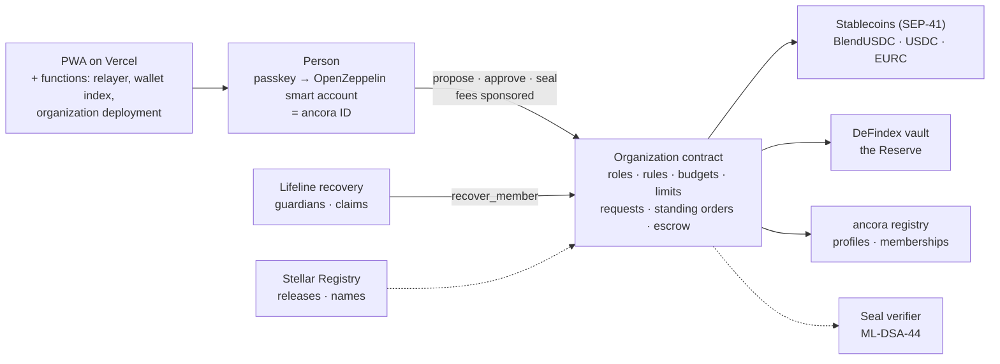

<p align="center">
  <picture>
    <source media="(prefers-color-scheme: dark)" srcset="app/public/brand/lockup-dark.svg" />
    
  </picture>
</p>

<h3 align="center">The business account your organization controls.</h3>

<p align="center">
  A programmable stablecoin account for clubs, companies, NGOs and teams.<br/>
  One passkey per person, one contract per organization, rules the account enforces itself.
</p>

<p align="center">
  <a href="https://ancora-gray.vercel.app"></a>
  <a href="https://github.com/raglibol-re/ancora/actions/workflows/ci.yml"></a>
  
  
</p>

<p align="center">
  
</p>

<p align="center">
  <sub>The app on sample data; every sample screen is labelled <em>Simulated</em>. On the Stellar testnet the same screens read from the organization's own contract.</sub>
</p>

> ancora is not a bank. Balances are not deposit-insured, and nothing here is a savings account. ancora runs on the Stellar **testnet** while it is prepared for production; no real money is involved.

## Mission

Give every organization one shared account where the rules its members agree on are the rules its money follows. A rowing club, a design studio and an aid group should be able to run their money with the controls of a large company, without a back office and without handing custody to anyone.

## Status

ancora is an open-source product in public preview, built in the open towards a mainnet launch with pilot organizations.

| Stage | Scope |
|---|---|
| **Now: public preview** | Every feature below runs on ancora's contracts on the Stellar testnet with test money. Eleven end-to-end flows run against the live site every night. |
| **Next: proven on testnet** | Reproducible, attested contract releases; monitoring with alerts; account history beyond the RPC's one-week window. |
| **Then: privacy and keys** | The confidential pot out of preview, approval tiers over hidden amounts, succession reminders. |
| **Then: mainnet** | An external security review of every contract, a licensed partner for euro bank transfers (KYB and fiat stay with the partner), the first pilot organizations. |

Deliverables and acceptance checks per stage: [docs/ROADMAP.md](docs/ROADMAP.md#scf-46-milestones).

## Try the preview

1. Open **[ancora-gray.vercel.app](https://ancora-gray.vercel.app)** and choose **Get started**. Your passkey (Face ID, fingerprint or device PIN) creates your pass: your own account on Stellar, with no seed phrase and no XLM to buy.
2. **Create an organization** from a template. It is deployed as its own contract, with you as founder.
3. **Add money** on the overview: take test BlendUSDC from ancora's operator.
4. **Send money.** The rule preview shows what your rules require before you submit; approve from the inbox with a second pass.
5. Explore the **Reserve**, **budgets and spending limits**, **standing orders**, **payment links**, a **deal** with another organization, or **Lifeline** guardians for your pass.

If the testnet or ancora's server doesn't answer, the app switches to labelled sample data and says so.

## Why ancora

Organizations want to hold stablecoins, but no treasurer puts company money in an account that is lost with a seed phrase, that one person can empty, and that ignores the organization's own approval rules. ancora puts those rules into the account.

- **You are your passkey.** It creates your own OpenZeppelin smart account on Stellar. Its address, your *ancora ID*, holds your positions in any number of organizations. Fees are sponsored.
- **Each organization is its own contract.** It holds the money and enforces the rules: approval tiers by amount, four-eyes, objection windows, extra approval for new recipients, budgets per category, spending limits per person. The rules are one readable document whose fingerprint the contract stores.
- **Several stablecoins, one home currency.** BlendUSDC, Circle USDC and Circle EURC are preset; any Stellar asset can be accepted. Payments in another currency are judged by a live exchange rate or take the strictest tier.
- **A Reserve for idle money.** One tap moves money into a DeFindex vault and back; earnings are variable and shown as they accrue.
- **A quantum-safe seal.** Large payments can require an extra signature with an ML-DSA-44 (FIPS 204) key held on the approving device, verified on-chain before the money moves.
- **Continuity.** A second passkey, Lifeline guardians who hand your positions to a new pass, and successors for members who go quiet. Control is restored; money never moves.

## Features

Status: **Testnet** runs on ancora's contracts on the Stellar testnet · **Preview** runs on testnet but is not yet hardened · **Simulated** is sample data only.

**Accounts and recovery**

| Feature | What it does | Status |
|---|---|---|
| Your pass | Passkey sign-in, on-chain profile (name, picture), ancora ID with QR code, positions across organizations | Testnet |
| Second passkey | Another passkey for the same account: a security key, this device, or another phone | Testnet |
| Lifeline | Guardians, a threshold and a waiting period; after a confirmed claim, every organization hands your position to your new pass. The old pass can cancel while the claim waits | Testnet |
| Succession | A successor takes over a member's position after a quiet period, so rules like two-of-two never deadlock | Testnet |

**Rules and approvals**

| Feature | What it does | Status |
|---|---|---|
| Approval rules | Tiers by amount, four-eyes, objection windows, new-recipient approval, a setup phase, a lock-out guard; enforced by the organization contract | Testnet |
| Roles | The organization's own roles, ordered by seniority; a higher role approves wherever a lower one is asked | Testnet |
| Budgets | An envelope per category and period; a soft budget escalates, a hard budget refuses | Testnet |
| Spending limits | An amount per day, week or 30 days per member (or per automated key), by asset or budget category | Testnet |
| Recipient allowlist | Payments to unlisted recipients take the strictest tier or are refused | Testnet |
| Discussions | Reasons for and against, questions and reactions on every request | Testnet (stored off-chain) |

**Payments**

| Feature | What it does | Status |
|---|---|---|
| Send money | One payment, or up to 50 as one batch (CSV import), approved once and paid in one transaction | Testnet |
| Standing orders | Weekly, fortnightly or monthly payments, each run judged by the rules like a one-off | Testnet |
| Payment links | Invoices and fees as a link or QR code, paid from any Stellar wallet | Testnet |
| Secure handover | Money set aside on approval and released when recipient and organization both confirm | Testnet |
| Deals | Milestone escrow between two organizations, each step under each side's own rules, with an optional arbiter | Testnet |
| Address book | Saved recipients shared by all members | Testnet |
| Bank in and out | Deposits and withdrawals through a Stellar anchor (SEP-10, SEP-24); the anchor's form takes the bank details | Testnet (SDF test anchor); IBAN card Simulated |

**Treasury and reporting**

| Feature | What it does | Status |
|---|---|---|
| Multi-asset balances | Balances per stablecoin with a headline total in the home currency | Testnet |
| Reserve | Per-asset DeFindex vault (Blend strategy), value and earnings read from the vault | Testnet (BlendUSDC) |
| Activity and statements | Searchable history from the ledger's events, monthly statements, CSV export | Testnet |
| Add money | From Freighter, Hana, xBull or Albedo, or test money from ancora's operator | Testnet |

**Privacy and security**

| Feature | What it does | Status |
|---|---|---|
| Private details | References, batch lines and recipient names encrypted with the organization's key; members and named auditors read them, nobody else | Testnet |
| Confidential pot | Balances and transfers between pots hidden on the network with zero-knowledge proofs made in the browser | Preview |
| Quantum-safe seal | ML-DSA-44 signatures from a device-held key, verified by ancora's on-chain verifier | Testnet |
| Notifications | Web push for approvals, outcomes and recovery attempts | Testnet |

**Platform**

| Feature | What it does | Status |
|---|---|---|
| Contract upgrades | Settings compares the organization's code with the latest release on the Stellar Registry; moving to it is a change the members approve | Testnet |
| Registry name | The organization's contract registered under a name on the Stellar Registry | Testnet |
| English and German | Every screen in both languages, money and dates formatted per language; contract error messages stay in English | Live |
| Sample mode | The whole app on labelled sample data, with "Viewing as" to act as any member | Simulated |

Organizations keep the contract release they were created with; features added in later releases show as unavailable until the members approve an upgrade.

<p align="center">
  
  
  
  
</p>

## How it works



A person signs with their passkey through their own account; the organization contract checks its own rules and moves the money. ancora's server never holds a key that can act for an organization: its operator key deploys organizations, sponsors fees and hands out test money.

- **App:** Vite, React and TypeScript, installable as a PWA. A pure domain layer (rules engine, money, request lifecycle) sits behind adapters for Stellar, the passkey kit, DeFindex, anchors and ancora's API, with sample data and the testnet as interchangeable data sources.
- **Contracts:** a Rust workspace on `soroban-sdk` 28 and OpenZeppelin stellar-contracts 0.8, one crate per contract. The TypeScript engine and the organization contract are tested against the same rule vectors.
- **Server:** Vercel Functions for the fee relayer (fail-closed: it only pays for calls to ancora's own contracts), organization deployment, scheduled runs, Lifeline completion, test money and a small Postgres store for the few records that don't belong on-chain.

More: [Architecture](docs/ARCHITECTURE.md) · [Decisions](docs/DECISIONS.md) · [Roadmap](docs/ROADMAP.md) · [Changelog](CHANGELOG.md)

## Testnet contracts

Written to `app/.env.testnet` by `scripts/setup-testnet.sh`, which builds, uploads and deploys ancora's contracts from `contracts/`.

| Contract | Address | Source |
|---|---|---|
| ancora registry: profiles, organizations per person | [`CDPQV7…4QCM`](https://stellar.expert/explorer/testnet/contract/CDPQV7C2XRWVDGWBIEHNE6IOMC56KSAITMESJBI7BULJSIGSVAQD4QCM) | `contracts/registry` |
| ancora Lifeline recovery | [`CDO3YV…X2PE`](https://stellar.expert/explorer/testnet/contract/CDO3YV5KMKPZTJLTLODIKNBYSTPJYLDKFKXOAGE52NJXF7FZMLACX2PE) | `contracts/recovery` |
| ancora seal verifier (ML-DSA-44) | [`CDUFVN…V4NS`](https://stellar.expert/explorer/testnet/contract/CDUFVNCHZE64O37RQZQQ6ZKYDLS3RZ6YKYJDD66XNEPYHVWW6OO6V4NS) | `contracts/seal_verifier` |
| ancora organization: one instance per organization | Wasm hash `VITE_ORG_WASM_HASH` in `app/.env.testnet` | `contracts/organization` |
| Stellar Registry open channel: releases and names | [`CDBL7M…HY4S`](https://stellar.expert/explorer/testnet/contract/CDBL7MNO7UI5OAAIC67UIWKQ4P3S6RVQSFCQXUHUW6TOFCXSYRPNHY4S) | stellar-registry |
| BlendUSDC | [`CAQCFV…RCJU`](https://stellar.expert/explorer/testnet/contract/CAQCFVLOBK5GIULPNZRGATJJMIZL5BSP7X5YJVMGCPTUEPFM4AVSRCJU) | Blend testnet |
| Circle USDC | [`CBIELT…DAMA`](https://stellar.expert/explorer/testnet/contract/CBIELTK6YBZJU5UP2WWQEUCYKLPU6AUNZ2BQ4WWFEIE3USCIHMXQDAMA) | Circle |
| Circle EURC | [`CCUUDM…MCGZ`](https://stellar.expert/explorer/testnet/contract/CCUUDM434BMZMYWYDITHFXHDMIVTGGD6T2I5UKNX5BSLXLW7HVR4MCGZ) | Circle |
| Reserve: DeFindex USDC vault | [`CBMVK2…DWHN`](https://stellar.expert/explorer/testnet/contract/CBMVK2JK6NTOT2O4HNQAIQFJY232BHKGLIMXDVQVHIIZKDACXDFZDWHN) | paltalabs/defindex |
| Passkey (WebAuthn) verifier | [`CC7EKI…OM3F`](https://stellar.expert/explorer/testnet/contract/CC7EKIHQP3TN4CARQDND6CEOY2UXLWWC2X5GHTD5NLAT7BG5GPZIOM3F) | stellar/smart-account-kit |
| Operator account (deploys, sponsors fees; never a signer) | [`GC2BKJ…YJE3`](https://stellar.expert/explorer/testnet/account/GC2BKJOG56UXZQKMV475BNHMEHUA54GPGY6W2FILRB4DHCOJFJXOYJE3) | — |

The deal, keyring and confidential-pot contracts are listed in `app/.env.testnet`. In the app, expert mode shows every deployment with explorer links.

## Development

Requirements: Node 24 and pnpm 10; for contracts, the Rust toolchain pinned in `contracts/rust-toolchain.toml` and the Stellar CLI 28.

```bash
cd app
pnpm install
pnpm dev        # http://localhost:5173
pnpm verify     # Biome, TypeScript, Vitest, production build (as in CI)
pnpm e2e        # eleven end-to-end flows against the live site, with virtual passkeys
```

```bash
cd contracts
cargo fmt --check && cargo clippy --all-targets -- -D warnings && cargo test
```

```bash
scripts/setup-testnet.sh                # fund the operator, build and deploy the contracts, write app/.env.testnet
scripts/setup-testnet.sh --check        # verify the deployment; exits 1 if anything is missing (e.g. after a testnet reset)
scripts/setup-testnet.sh --sync-vercel  # also push the server settings to Vercel and redeploy
```

Production deploys from `main` to one Vercel project (Root Directory `app`). Passkeys are bound to the production hostname, so passkeys made on preview URLs or localhost don't work there. Environment variables are documented in `app/.env.example`. Contributing rules: [CONTRIBUTING.md](CONTRIBUTING.md). Operations, accounts and open work: [docs/HANDOFF.md](docs/HANDOFF.md).

## Limits of the preview

- **Testnet only.** Test money, test network, no real funds.
- **Sample data** is labelled *Simulated* everywhere it appears, including the account-number (IBAN) card, which is always simulated.
- **Fees are sponsored** by ancora's operator. Testnet fees are currently far above mainnet's because testnet state exceeds its rent target ([details](docs/ARCHITECTURE.md)).
- **Test money:** BlendUSDC and Circle USDC refill automatically; Circle EURC depends on a captcha-gated faucet and is often unavailable, which the app shows per asset.
- **Scheduled runs** (standing orders, requests past their objection window) happen daily, when a member opens the organization, or on demand. Missed runs are skipped, not caught up.
- **Off-chain records:** discussions, pictures and notification subscriptions are stored by ancora's server, checked against the contracts, and not yet signed by the author's passkey.
- **Organizations are contract addresses (C…).** A plain Stellar payment can't reach them; use "Add money" or a wallet that can pay contracts.
- **The confidential pot is a preview:** not audited, and OpenZeppelin's proving setup is provisional.

## Get involved

- **Pilot organizations.** Clubs, NGOs and small companies that want to run real payments under their own rules once mainnet opens: write to [rami.ezzeddine@outlook.de](mailto:rami.ezzeddine@outlook.de?subject=ancora%20pilot%20request).
- **Issues and ideas** are welcome as [GitHub issues](https://github.com/raglibol-re/ancora/issues).
- **Code:** see [CONTRIBUTING.md](CONTRIBUTING.md) and run `pnpm verify` before opening a pull request.

## Built with

[stellar/smart-account-kit](https://github.com/stellar/smart-account-kit) · [OpenZeppelin stellar-contracts](https://github.com/OpenZeppelin/stellar-contracts) · [DeFindex](https://github.com/paltalabs/defindex) · [Blend](https://www.blend.capital) · [Stellar Registry](https://github.com/stellar-registry) · [Stellar Wallets Kit](https://github.com/Creit-Tech/Stellar-Wallets-Kit) · [@noble/post-quantum](https://github.com/paulmillr/noble-post-quantum) · [Noir](https://noir-lang.org) · [Frankfurter](https://frankfurter.app) · [Vercel](https://vercel.com)

## License

[Apache License 2.0](LICENSE).
