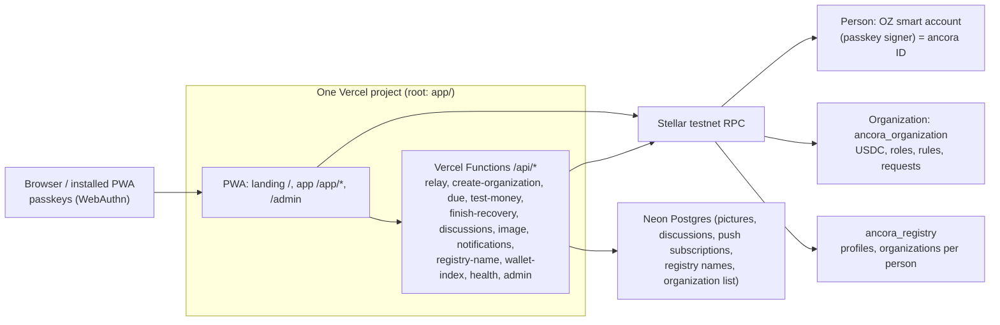

# Architecture

How ancora is built: what runs where, how the app is layered, what each contract does and who may call it, and what the server does on its behalf. The reasons behind each choice are in [DECISIONS.md](DECISIONS.md); how the system is operated is in [HANDOFF.md](HANDOFF.md).

## What runs where



- **Static app.** A Vite build served by Vercel. Every path except `/api/*` rewrites to `index.html` (`app/vercel.json`), so deep links survive a refresh. A Workbox service worker precaches the shell for installability and offline start.
- **Server functions** (`app/api/`). Thin handlers over shared modules in `app/api/_lib/`. Secrets live only in Vercel environment variables.
- **Operator key** (`DEPLOYER_SECRET`). Sponsors fees, deploys organization contracts and sends work that is already decided (due requests, standing orders, deal payouts). It is never a member, admin or signer of any organization or person.
- **Source of truth.** The Stellar testnet holds identities, organizations, rules, requests and balances.
- **Off-chain records.** The few records that can't or shouldn't live on-chain are in one Neon Postgres database, reached only through `app/api/_lib/database.ts`. See [Off-chain data](#off-chain-data).
- **Scheduled work.** A daily Vercel cron calls `/api/due`. See [Scheduled jobs](#scheduled-jobs).

## App layering

```
app/src/domain      pure logic, no React, network or Stellar SDK
   ^
app/src/adapters    the outside world, behind interfaces defined in domain/
   ^
app/src/features/*  UI per feature, using app/src/ui (presentational) and
                    app/src/styles/tokens.css (design tokens)
```

- `app/shared/` holds the few modules both the app and the Functions import: the token balance read, the RPC server factory and the policy document.
- UI state lives in `features/workspace`: the snapshot and identity through `useSyncExternalStore`, preferences and the active organization. The snapshot refreshes every 30 seconds.
- `useCommand` gives every action the same flow: signature prompt (an in-app prompt in sample mode and for the security seal; otherwise the device's real passkey prompt) → command → plain-language success or error.
- `domain/pendingWork.ts` tracks what runs in the background. The testnet adapter wraps every passkey prompt, wallet signature and submission in it, and the shell's `WorkingBar` shows the latest label.
- `features/profile` is the person's page; `features/settings` is the organization's.

### Approval rules engine

Pure TypeScript in `app/src/domain/rules/`, no I/O:

| Module | Responsibility |
|--------|----------------|
| `model.ts` | Organization, ranked roles (0 = highest), members, policy (tiers, seal threshold, new-recipient rule), errors |
| `templates.ts` | Club, company and team defaults |
| `policy.ts` | Policy validation; payment evaluation (tier, required approvals, objection window, seal); governance evaluation (strictest tier) |
| `approvals.ts` | Slot matching: requester excluded, one slot per person, higher roles fill lower slots |
| `requests.ts` | Request lifecycle: pending → scheduled (objection window) → ready → executed, or declined |
| `governance.ts` | Member, rule and template changes; setup phase; template switching by rank; lock-out guard |
| `controls.ts` | Allowances per asset and category, recipient rule, exchange rates for the tiers |
| `policyDocument.ts` | The rules as one canonical document and its SHA-256 |

- `contracts/test-vectors/approval-rules.json` pins the behaviour. Both this engine and the contract's `rules.rs` are tested against it (`contracts/organization/src/test_vectors.rs`).
- Sample mode runs this engine. On testnet the UI uses it for previews and error text; the contract decides.

### Languages

- English and German. The English text is the key: `t()` from `ui/i18n.ts` looks it up in `ui/messages/de.ts`.
- The domain and the adapters stay English and have no UI imports. Screens translate their messages where they display them; a failure reported as "what failed: why" is translated part by part.
- A test checks that every text passed to `t()` / `msg()` and every contract, deal and pot error has a German translation.

## Data sources

Features never talk to the outside world directly. They use one `DataSource` interface (`app/src/domain/dataSource.ts`):

- a snapshot of the person's workspace, plus commands;
- `identity` (optional): sign-in, sign-out, profile, for sources where the person is real;
- `funding` (optional): connect a Stellar wallet and deposit into an organization. The testnet adapter backs it with Stellar Wallets Kit, loaded on demand (`walletFunding.ts`);
- `discussions`: post, react, mark answered.

| Implementation | Where | Status |
|----------------|-------|--------|
| `SampleDataSource` | `app/src/adapters/sample/` | Labeled sample data. Every command runs through the domain engine and is persisted in browser storage. "Viewing as" replaces sign-in. Stays as the demo fallback. |
| `TestnetDataSource` | `app/src/adapters/testnet/` (lazy-loaded chunk) | Real, on Stellar testnet. Reads by simulation (`readContract.ts`) and maps the result with `mapOrganization.ts`. Commands go through the person's smart account; see [Identity and auth flows](#identity-and-auth-flows). The class holds the session and what it reads; commands live in `requestCommands.ts` and `organizationCommands.ts`, joined in `TestnetDataSource.open()`. |

### Choosing a source

1. On load the app asks `/api/health` for the site-wide default (`DEFAULT_DATA_SOURCE`) and whether the Stellar RPC answers (12-second timeout, `adapters/site/siteHealth.ts`).
2. `resolveDataSource` combines that with the person's own preference. Sample data never waits for the network.
3. Testnet is used only when the build has its configuration and the RPC is reachable. Otherwise sample data is shown, with the reason in the banner and a retry.
4. On testnet the app restores the passkey session or shows the sign-in page: create a passkey (= create an account), sign in with an existing one, or look around with sample data.

### What the testnet adapter reads

- **Workspace.** The registry's `orgs_of(person)`, then per organization its `info`, `policy`, `assets`, `members`, `requests`, `is_setup_phase` and `policy_hash`, one token balance per accepted asset, `reserve(token)` for assets with a vault, and profiles.
- **Ledger history** (`orgHistory.ts`). Movements come from the token contracts' events (`transfer`, and `mint` for issued test money) where the organization is sender or recipient, not from what the app itself submitted.
  - The newest chunk is read while the organization loads; `backfillTransfers` reads the rest of the past week afterwards (`eventScan.ts`: 8,000-ledger chunks, four in flight, one organization at a time).
  - What was read is kept per organization on the device (`historyCache.ts`, key `ancora.history.v1:<org>`, at most 400 entries), so later visits scan only new ledgers and entries outlive the RPC's window.
  - `mapOrganization.ts` classifies transfers: from the organization's vault = Reserve withdrawal; to it = Reserve deposit; other inbound = deposit; other outbound = payment, matched to the executed request when token, recipient and amount agree. Every entry links to its transaction on the explorer.
- **Discussions.** Part of the snapshot (`OrgAccount.discussions`) but not of the 30-second refresh. Screens that show requests call `discussions.load` through `useDiscussions` when they open; organizations without requests are never asked. Every write answers with the organization's threads, so nothing is read twice. Sample data keeps them in browser storage; testnet uses `/api/discussions`.
- **Any asset** (`tokenInspect.ts`). Resolves a reference (a `C…` address, or `CODE:ISSUER` through `Asset.contractId`) and reads `symbol`, `name` and `decimals` from the token; the Rules page then proposes `AddAsset`. The operator allowlist `ORG_ASSETS` remains the source of presets, test money and labels.
- **Money view** (`features/overview/MoneyHeadline.tsx`). Sums every asset in the home currency and shows available, waiting and Reserve as an allocation bar. Other currencies convert through `domain/fx.ts` with quotes from `adapters/fx/frankfurterRates.ts` (`VITE_FX_RATES_URL`), falling back to the labeled `indicativeRates.ts`. Display only: the rules never read these rates.
- **Bank ramps** (`anchorRamp.ts`). Reads the anchor's `stellar.toml` (SEP-1), signs the person in with their wallet through Stellar Wallets Kit (SEP-10, challenge checked with the SDK's `WebAuth.readChallengeTx`), starts SEP-24 interactive deposits and withdrawals and polls `/transaction`. `RampSupport` on the data source hides this from the UI (`BankDepositSection`, `BankWithdrawSheet`); sample data has none.

## Identity and auth flows

| Thing | On-chain | Created by | Signs with |
|-------|----------|------------|------------|
| Person ("ancora ID") | OpenZeppelin smart account; WebAuthn signer = the person's passkey public key | smart-account-kit in the browser; address derived from the credential id | The passkey on the device (the private key never leaves the authenticator) |
| Organization | `ancora_organization` instance: roles (OZ AccessControl, admin = the contract itself), policy and its document hash, accepted assets, requests | The operator (`/api/create-organization`), with the founder as only member | Nobody: the contract acts when its own rules are satisfied |
| Registry | One `ancora_registry`: profiles, organizations per person, registered organizations | The setup script, once | Profile: the person. Membership: the organization. Registration: the operator |

One passkey, one person, any number of positions: the same address can be a board member in one organization and treasurer in another. Membership is a role grant on the organization plus an entry in the registry, so a new device finds everything from the passkey alone (`connectWallet` → `orgs_of` → each organization's state).

### Flows

- **Sign-up.** smart-account-kit creates a passkey (RP ID = the page's hostname) and deploys the OZ smart account with that passkey as its WebAuthn signer. The address is derived from the credential id, so one passkey always maps to one account. The person then writes their profile with `set_profile`, signed with the passkey.
- **Sign-in.** `connectWallet` restores the stored session silently or prompts for a passkey on this device. The kit verifies the account's creation transaction through the [wallet index](#wallet-index) before connecting.
- **Organization commands.** The person's account calls the organization with `execute(target, fn, args)`. The organization calls `member.require_auth()`, which Soroban treats as authorized because the account is the direct invoker; the passkey signs the account's auth entry and `__check_auth` verifies it on-chain. Fees are sponsored by [`/api/relay`](#relayer-validation).
- **Payments.** When a request is satisfied and any objection window has passed, the organization transfers the token from itself. `execute` is permissionless, so "Send now" asks the operator to submit it (`POST /api/due { organization, requestId }`). Before requesting, the app checks that a classic recipient holds a trustline for exactly that asset.
- **More devices.** A second passkey on the same account (`DevicesSection`, `kit.signers.addPasskey`) signs for the same pass. For a lost passkey, see [Lifeline](#lifeline-recovery-of-a-pass).
- **Device keys from the passkey** (`adapters/testnet/passkeyKeys.ts`). New passkeys are created with the PRF extension. When a device key or seal seed is first made, the passkey is asked for its PRF secret (fixed salt) and HKDF-SHA256 derives both from it; without PRF they are random. "Bring back with my passkey" (`passkeyRestore.ts`) derives them again and keeps each only where it matches what the person published (keyring key, an organization's `seal_key`).

## Contracts

`contracts/` is a Rust workspace (soroban-sdk 28, OpenZeppelin stellar-contracts 0.8), one crate per contract. Every public function documents its auth in a doc comment.

### organization

One instance per organization. Holds roles, policy, accepted assets and requests; balances live in the token contracts.

- **Constructor.** `__constructor(registry, recovery, releases, base_currency, assets, founder, founder_role, template, name, policy_hash)`. The contract is its own AccessControl admin, so positions change only through its governance; the deployer holds no role.
- **Who may call what.**
  - Members propose: `propose_payment`, `propose_batch`, `propose_change`, `propose_deal`, `propose_pot`, `set_standing_order`, `create_link`, `set_payee`.
  - Members decide: `approve`, `seal` / `seal_with_key`, `decline`.
  - The founder acts directly during the setup phase (`change_directly`, `deal_directly`, `pot_directly`): while nobody else can satisfy the strictest tier.
  - Treasury rights (the top role, or a role that could approve the strictest tier): `move_to_reserve`, `withdraw_from_reserve`.
  - Anyone: `execute` (once a request is ready), `run_standing_order` (once due), `finish_succession` (after the wait).
  - The recovery contract named at deployment: `recover_member`.
- **Requests.** Each request snapshots its evaluation. A fully approved request with an objection window becomes `Scheduled` with `execute_after`; otherwise it executes at once (token transfer with contract-invoker auth, or the change plus `registry.set_membership`). Every state change emits a `RequestEvent`.
- **Governance changes** (`Change`). `UpdatePolicy`, `AddAsset` / `RemoveAsset`, `SetRoles` (1–8 ranked roles; refused while a dropped role still has members), `SetSpendingLimit`, `SetAllowance`, `SetRecipients`, `SetFxOracle`, `SetSuccessor`, `SetSealVerifier`, `Upgrade`, plus member changes. They go through the same approval rules, at the strictest tier.
- **Assets.** `Asset { token, currency, symbol, decimals }`. Symbol and decimals are read from the token when it is accepted, so a non-token address is refused. `available(token)` subtracts what open requests have promised. Removing an asset needs a zero balance, no open request in it, and at least one other asset.
- **Currency of the rules.** The rules are written in `base_currency`. A payment in another currency takes the strictest tier and the seal, unless a SEP-40 oracle is set (`SetFxOracle`): then its `lastprice` converts the amount (rounded up, at most four days old). Budgets and the general spending limit count only the base currency.
- **Payment features.**
  - Batches: `propose_batch`, 1–50 lines, evaluated on the total, paid in one execution.
  - Standing orders: `set_standing_order`, `cancel_standing_order` (owner or top role), `run_standing_order` (proposes through the same path as `propose_payment`; missed runs are skipped).
  - Payment links: `create_link` (1–500 payments), `pay_link` (the payer's own authorization; each payer once), `close_link`. The public page `/pay/:org/:link` reads them without an ancora pass (`adapters/testnet/publicLink.ts`) and pays through Stellar Wallets Kit.
  - Address book: `set_payee` / `remove_payee` (names ≤ 64 bytes, notes ≤ 140, at most 200 entries).
  - Secure handover: a payment with `escrow` becomes `Escrowed` on execution; `confirm_escrow` from both the recipient and the sender side pays out; `cancel_escrow` (sender side) frees the committed amount. The recipient page is `features/escrow/EscrowPage.tsx`.
- **Limits and budgets.**
  - Spending limits (`SetSpendingLimit`) and allowances per asset and category (`SetAllowance`): a payment that fits the requester's rolling window needs no approval.
  - Recipient rule (`SetRecipients`): open, approve or only.
  - Budgets (`Policy.budgets`, `Budget { category, amount, period_seconds, hard }`): `propose_payment` books against a rolling window per category and either marks the request over budget (strictest tier) or, for a hard budget, refuses it. `decline` releases the booking.
- **Reserve.** An asset may carry a DeFindex vault (`Asset.vault`). Moving money in or out needs no request, since it never leaves the organization, but requires treasury rights. The contract calls the vault directly and pre-authorizes the vault's token pull as a sub-invocation. The vault is also the share token, so its balance plus `get_asset_amounts_per_shares` give the Reserve's value; the contract keeps the principal per token so the app can show earnings (variable). `reserve(token)` returns vault, shares, value and principal.
- **Continuity** (`continuity.rs`). Member actions record when they were last seen. `SetSuccessor` names who takes over after a quiet period; the successor calls `claim_succession`; any member action or `still_here` cancels the claim; `finish_succession` gives the successor the higher role and removes the member.
- **Seals with a device key** (`seal_key.rs`). With `SetSealVerifier`, seals require `seal_with_key(by, id, signature)`: ML-DSA-44 over `seal_payload(id)` = SHA-256(organization address XDR ‖ id XDR), checked by [seal_verifier](#seal_verifier) against the key the member published with `set_seal_key`. The app keeps the seed in IndexedDB (`adapters/testnet/sealKey.ts`, `@noble/post-quantum`) and signs on the device.
- **Deals and the pot.** The organization takes part in [deals](#deal) and holds its own [pot](#pot-pot_verifier-pot_auditors) account. Both are requests under its rules (`Deal(DealCall)`, `PotAction`). On execution the organization calls the other contract itself, which satisfies that contract's `require_auth`, and authorizes a deposit's token pull with `authorize_as_current_contract`. A failed step records 1000 + the deal's error code or 2000 + the pot's.
- **Upgrades.** `Change::Upgrade(hash)` is accepted only when the hash is the latest `ancora-organization` release on the Stellar Registry the organization was deployed with (`fetch_hash`). It is checked when proposed and again when applied, and swaps the code with `update_current_contract`.
- **Interface version.** `version()` reports what the code offers (currently 10; the list is at `CONTRACT_VERSION` in `lib.rs`). The app uses it to show only what an organization supports; organizations from before the view read as 0.
- **Code layout.** `rules.rs` is the pure engine (same semantics as the TypeScript one), `templates.rs` the three templates, `types.rs` the errors and data types; `controls.rs`, `continuity.rs`, `seal_key.rs`, `deals.rs` and `pot.rs` hold the later interfaces.

**Policy document.** The app builds `{ ancora: "policy/3", template, roles, unit: "cent", currency, tiers, sealThreshold, newRecipientApprovals, budgets }` in the canonical form of stellar-registry/perch (CANON v1: no whitespace, sorted keys, `u32` numbers only, amounts as decimal strings, no null, no booleans) and hashes it with SHA-256. Version 2 is still computed to verify older organizations. The hash goes into the constructor and into every `UpdatePolicy`; the Rules page recomputes it from the contract's state and shows whether it matches. The design follows perch's declarative policy without depending on it; cumulative limits are the organization's own spending limits (see DECISIONS).

### registry

One shared instance; holds no money.

- `register_org(org, founder)`: the operator (admin).
- `set_membership(org, member, is_member)`: the organization itself, as direct invoker when it applies a change.
- `set_profile(who, name, avatar)`: the person.
- Views: `orgs_of`, `is_registered`, `profile`.
- Server functions treat a contract as an ancora organization when the registry says `is_registered`, not by its Wasm hash, so organizations built from earlier releases still count.

### recovery

Lifeline; one shared instance. See [Lifeline](#lifeline-recovery-of-a-pass) for the flow.

- Per person a `Plan { guardians, threshold, wait_seconds }` (one to five guardians) and at most one open `Claim { successor, approvals, started_at, ready_at }`.
- `set_plan` / `clear_plan` / `cancel_claim`: the person. `start_claim` / `approve_claim`: a guardian.
- `finish_claim(person, orgs)`: no auth. Needs the threshold and the waiting period, then calls `recover_member` on each listed organization and records `recovered_to`.
- Views: `plan`, `claim`, `protects(guardian)`, `recovered_to`. The app maps errors in `adapters/testnet/lifelineContract.ts`.

### deal

Milestone escrow between parties: one instance, one persistent entry per deal, no admin.

- Party A creates and funds, approves releases and may object; party B accepts and requests releases; either party may cancel or dispute; the arbiter named in the terms resolves.
- `execute_release` needs no auth: the money only goes to B. The daily `/api/due` run triggers due automatic payouts (`api/_lib/dueDeals.ts`), and the relayer trusts the deal contract so a member can trigger one too.
- In an organization, a deposit or payout approval is evaluated like a payment, everything else like a rule change, and a deposit is held back as committed money (`organization/src/deals.rs`).
- The app reads `deals_of(organization)` (`adapters/testnet/dealSupport.ts`, `dealCodec.ts`) and shows Deals with a page per deal (`features/deals`).

### keyring

Keys for private details.

- `set_key(person, key)`: the person's X25519 public key.
- `open_epoch(by, org)`: a member opens the organization's next key epoch; the first one turns private details on. Membership is read from the organization's `members()`.
- `share(...)`: a member wraps the epoch key for a member or auditor, recording which public key it was wrapped for, so a new device shows as waiting.
- `add_auditor` / `remove_auditor`: a member. `set_label`: a member stores an encrypted recipient label.
- In the app (`adapters/testnet/privacySupport.ts`, `privateCrypto.ts`): the X25519 secret stays in IndexedDB (`deviceStore.ts`); wrapping is ephemeral X25519 + HKDF-SHA256 + AES-GCM; notes are stored as `enc1:<epoch>:<base64url>` (`domain/privateNote.ts`).
  - References, batch lines, standing orders and discussion entries are encrypted on the way out and decrypted after each read (`revealPrivateNotes`); unreadable notes show as "Private note".
  - With private details on, `set_payee` stores the name "Private" and the real `{name, note}` goes to the keyring encrypted (`adapters/testnet/privateLabels.ts`).
  - The Audit page reads any organization through `privacy.audit`, opens what was shared with the auditor and exports it with the same statement builder as Activity.

### seal_verifier

Stateless ML-DSA-44 (FIPS 204) verifier, one instance per network, implementing OpenZeppelin's external-verifier interface: `verify(signature_payload, key_data, sig_data) -> bool` over a 32-byte payload (empty context), plus `canonicalize_key` / `batch_canonicalize_key` (identity). The organization calls it for [seals with a device key](#organization).

### pot, pot_verifier, pot_auditors

A confidential pot, shipped as a preview.

- `pot` is OpenZeppelin's confidential token (stellar-confidential 0.8.0) with `NoHooks` and no admin, over one asset. Balances are Pedersen commitments on Grumpkin; every spend carries a proof the pot checks through the verifier.
- `pot_verifier` registers the five core circuits' UltraHonk keys in its constructor (built into the Wasm; see its `vks/README.md`) and refuses any change.
- `pot_auditors` lets anyone register their own Grumpkin key under the next free number; only its owner can rotate it.
- The organization holds its pot account itself. Members propose `PotAction`s (register, deposit, withdraw, confidential payment) as requests; the contract can't see a confidential amount, so it takes the strictest tier.
- In the app (`app/src/adapters/testnet/pot/`):
  - The organization's keys derive from a 32-byte root kept as a keyring label on the pot's address, sealed with the organization's key (`potRoot.ts`).
  - Proofs are made in the browser with noir_js and bb.js; circuit artifacts are in `app/public/circuits` and checked against the verifier's keys before the first proof.
  - Openings are rebuilt from the pot's events and checked against the commitments on-chain (`potWallet.ts`), starting from this device's encrypted snapshot when one exists (`potSnapshot.ts`, AES-GCM in localStorage; a snapshot that no longer explains the chain is dropped for a full replay). Incoming money is merged before a spend.
  - Approvers read a pending payment's amount through the organization's auditor channel ("Show the amount").
  - Activity and the statement CSV add the pot's private payments (`potItems` in `domain/statement.ts`). Moving money into or out of the pot is already a public movement of the account, so it isn't counted twice.

### Shared deployments and releases

- From smart-account-kit's testnet deployments: the OZ smart account Wasm and the WebAuthn and Ed25519 verifiers. The kit's threshold and spending-limit policies are not used; see DECISIONS on spending limits.
- `scripts/publish-registry.sh` publishes `ancora-organization`, `ancora-registry`, `ancora-recovery` and `ancora-seal-verifier` to the Stellar Registry's open channel with `publish_hash` (dry run unless `--publish`; skipped when the hash is already the latest).
- Settings → Organization code (`adapters/testnet/releases.ts`) compares the instance's Wasm hash with the latest release.
- New organizations are still deployed by the operator from the uploaded Wasm hash (`ORG_WASM_HASH`), the same code as the latest release.
- **Registry names.** `adapters/testnet/registryNames.ts` resolves names with `fetch_contract_id` on the Stellar Registry (`VITE_STELLAR_REGISTRY_CONTRACT`) and builds `register_contract(name, organization, owner)`, which the person's account calls through the relayer. `/api/registry-name` remembers the chosen name per organization, since the registry only resolves name → contract; the app verifies it against the registry on every read.

## Server functions

Twelve functions, the Vercel Hobby plan's limit; related actions share one function.

| Function | Purpose | Auth |
|----------|---------|------|
| `relay` | Sponsors fees for smart-account calls | [Validation](#relayer-validation) |
| `create-organization` | Deploys and registers an organization with the founder as only member | Assets only from `ORG_ASSETS` |
| `due` | Runs what is due; executes one request or standing order; indexes an organization | See [Scheduled jobs](#scheduled-jobs) |
| `finish-recovery` | Submits `finish_claim` for a person | None needed: the recovery contract checks guardians and time |
| `test-money` | Sends test stablecoins from the operator's float to an organization | Testnet only; the operator can give, not take |
| `discussions` | Discussion entries and reactions | Membership read from the organization contract |
| `image` | Stores and serves pictures by content hash (≤ 300 KB, type checked) | None: the on-chain owner decides which picture an address shows |
| `notifications` | Web push subscriptions per person and device | None: notifications repeat only public on-chain facts |
| `registry-name` | Name per organization on the Stellar Registry | Members only |
| `wallet-index` | Passkey → account lookup for smart-account-kit | Public |
| `health` | Site default data source, RPC status | Public |
| `admin` | Demo admin: status, running what is due, operator fee top-up | `ADMIN_PASSPHRASE` |

### Relayer validation

The kit POSTs `{ func, auth }` to `/api/relay`. `api/_lib/relayRules.ts` checks it fail-closed, modelled on smart-account-kit's reference relayer proxy:

- Only `{ func, auth }`, one to eight auth entries.
- Deployments: only the accepted smart-account Wasm, from the kit's shared deployer, with exactly one passkey signer whose credential id derives the address.
- Calls on a smart account: only `execute` and the account's own signer/policy/context-rule functions, and only on a contract running the accepted smart-account Wasm.
- `execute` targets: the registry, recovery, deal and keyring contracts, the pot auditors, the Stellar Registry, or a registered organization.
- Token `transfer`: only from an ancora smart account.
- Every authorization uses address credentials from that account and matches the submitted call exactly. Source-account credentials are always refused, so the operator never authorizes anything.
- The simulated resource fee must be at most 300 XLM.

Only then is the operator key read and the transaction submitted with the operator as fee source. After the response, `api/_lib/notify.ts` sends notifications in `waitUntil`; a failure there never affects the transaction.

### Server transactions

Every call the operator makes goes through `invokeAsServer` (`api/_lib/ledger.ts`):

- The operation keeps the operator as its source, so it authorizes only its own calls.
- The transaction comes from one of eight channel accounts derived from the operator's secret (`api/_lib/channels.ts`, created on first use); the operator pays through a fee bump.
- A sequence clash on a channel is retried on another. A dropped transaction is resent only after its 20-second validity window.

### Notifications

- After a successful relay, `notify.ts` reads what the person's `execute(target, fn, args)` did: a new request notifies the other members; approve, seal or decline notifies the requester with the outcome; a Lifeline `start_claim` notifies the person.
- Sent with `web-push` and VAPID keys. Subscriptions are rows per person and device (`api/_lib/pushStore.ts`). `public/push-sw.js` is imported into the Workbox service worker and shows them.

### Wallet index

smart-account-kit connects a passkey to its account only after verifying the account's creation transaction, which it asks an indexer for. Mercury's testnet indexer lists ancora's wallets but leaves that transaction empty, so ancora answers the lookup itself:

- `api/wallet-index/api/lookup/[credentialId].ts` answers in Mercury's schema-2 format.
- Candidates come from Mercury; the creation transaction is found on the ledger (`api/_lib/walletBirth.ts`) and completed by `api/_lib/walletIndex.ts`.
- The kit still verifies the transaction against the chain. The client points `indexerUrl` at this function, next to the relayer URL.

## Scheduled jobs

`api/due.ts` handles all work that is already decided and only needs someone to submit it. The contracts allow anyone to do this; the operator only pays the fee.

- **GET** (daily Vercel cron at 07:00 UTC with the `CRON_SECRET` bearer, or the demo admin with the passphrase): for every organization in the scheduler's list (`api/_lib/organizationIndex.ts`), runs due standing orders (`run_standing_order`), executes requests past their objection window (`execute`) and triggers due deal payouts. Returns a report the admin panel shows (`api/_lib/dueOrders.ts`, `dueDeals.ts`).
- **POST `{ organization, requestId }`**: executes one ready request ("Send now").
- **POST `{ organization, orderId }`**: runs one due standing order. The app does this for the person's own organizations when it sees one due.
- **POST `{ organization }`**: adds an organization to the scheduler's list. `create-organization` adds new ones; the app announces every other organization it opens, once per device (`adapters/testnet/schedulerAnnouncements.ts`).

## Off-chain data

One Neon Postgres database; schema in `app/db/schema.sql`, access only through `app/api/_lib/database.ts`. Anything new stored off-chain needs a justification in DECISIONS.

| Table | Holds | Why off-chain |
|-------|-------|---------------|
| `organizations` | The scheduler's list | Planned to move on-chain (see ROADMAP) |
| `registry_names` | Name per organization on the Stellar Registry | The registry resolves name → contract only |
| `discussion_entries`, `discussion_reactions` | Discussion on requests | Conversation, not account state |
| `push_subscriptions` | Web push endpoints per person and device | Device-specific, not account state |
| `images` | Profile pictures and logos, by SHA-256 | Too large for contract storage; the URL is written on-chain |

## Backups

The off-chain records in Neon are copied every night by `.github/workflows/backup.yml` (03:15 UTC, or started by hand):

- `app/db/backup.mjs` exports every table of `db/schema.sql` to JSON (rows only; the table list is `db/tables.mjs`).
- The workflow compresses the export, encrypts it with `BACKUP_PASSPHRASE` (AES-256-CBC, PBKDF2 with 200,000 rounds) and keeps it as a workflow artifact for 90 days.
- The repository is public and its artifacts can be downloaded by any GitHub user, hence the encryption.
- Needs the GitHub secrets `DATABASE_URL` and `BACKUP_PASSPHRASE`.

To restore:

1. Download the artifact (`gh run download <run id> -n ancora-backup-<run id>`).
2. Decrypt: `openssl enc -d -aes-256-cbc -pbkdf2 -iter 200000 -pass env:BACKUP_PASSPHRASE -in backup.json.gz.enc | gunzip > backup.json`.
3. Point `DATABASE_URL` at the target database, then `cd app && pnpm db:schema && pnpm db:restore backup.json`. Rows that already exist are kept, so restoring into a database that is still in use only fills in what is missing.

The restore was last drilled on 15 Nov 2026, into an empty database on a Neon branch: every row came back, and a second run added nothing.

## Lifeline (recovery of a pass)

A person's pass is an OpenZeppelin smart account with their passkey as signer; losing the passkey must not lose their positions.

- The [recovery contract](#recovery) (`contracts/recovery`, one shared instance) holds each person's plan: one to five guardians (other ancora passes), how many must confirm, and a waiting period.
- A guardian starts a claim naming the person's new pass; the others confirm. While the claim waits, the old pass can cancel it.
- Once enough guardians have confirmed and the waiting period is over, anyone can finish it. `/api/finish-recovery` submits it for the person, so the new pass needs no XLM.
- Every organization built with the recovery contract hands the person's position, spending limit and allowances to the new pass (`recover_member`). Recovery never moves money.
- Organizations deployed before Lifeline can't take part and are reported to the person.

A second passkey on the same account (`DevicesSection`, `kit.signers.addPasskey`) is the lighter alternative: it signs for the same pass, so nothing has to be handed over.

## Multi-tenancy

- One person, many organizations, one role per organization.
- Organizations are fully isolated: separate contracts, separate balances, separate rules.
- The registry is the only shared index, and it holds no money.

## Testnet notes

Measurements that change with the network. Each states when it was taken.

- **Rent** (measured 25 Oct 2026). Testnet's live Soroban state was above its 4 GB rent target (4.10 GB and rising), so rent was 2,271,304 stroops/KB (mainnet: 1,000). The OZ smart account extends every persistent entry to a 30-day TTL on each read (`SMART_ACCOUNT_EXTEND_AMOUNT`). Together: deploying an account cost 22 XLM, a first deposit 22 XLM, a first passkey payment 46 XLM; the same on mainnet is well under 1 XLM. This is why the relayer sponsors from a Friendbot-refilled operator key instead of OpenZeppelin Relayer Channels (100 XLM/day cap), and why its fee cap is 300 XLM.
- **RPC event window.** RPC keeps about a week of events (120,960 ledgers) and scans at most 10,000 ledgers per `getEvents` request. Hence the 8,000-ledger chunks and the on-device history cache described under [What the testnet adapter reads](#what-the-testnet-adapter-reads).
- **Organization Wasm size** (measured 3 Nov 2026, local release build). 122,626 bytes (about 120 KiB) of the network's 128 KiB contract size limit. New features may need to move into separate contracts.
