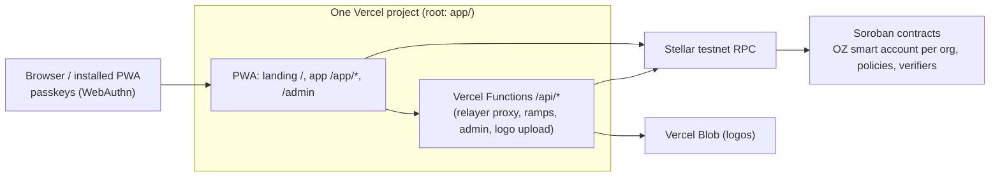

# Architecture

> Living document. Sections marked *(planned)* describe the target design and are filled in as each task lands.

## What runs where

- **Static app**: Vite build served by Vercel; every path except `/api/*` rewrites to `index.html` so deep links survive refresh. A Workbox service worker precaches the shell for installability and offline start.
- **Server-side** (`app/api/`): thin handlers calling adapters. Secrets live only in Vercel environment variables.
- **Source of truth**: the Stellar testnet (accounts, rules, requests, balances). No database by default (see DECISIONS.md).

## Front-end layering

`app/src/domain` (pure) ← `app/src/adapters` (outside world, behind interfaces) ← `app/src/features/*` (UI) using `app/src/ui` (presentational) and `app/src/styles/tokens.css` (design tokens).

## Approval rules engine

Pure TypeScript in `app/src/domain/rules/`, no I/O:

| Module | Responsibility |
|--------|----------------|
| `model.ts` | Org, roles (ranked, 0 = highest), members, policy (tiers, seal threshold, new-recipient rule), errors |
| `templates.ts` | Club, company and team defaults |
| `policy.ts` | Policy validation; payment evaluation (tier, required approvals, objection window, seal); governance evaluation (strictest tier) |
| `approvals.ts` | Slot matching: requester excluded, one slot per person, higher roles fill lower slots |
| `requests.ts` | Request lifecycle: pending → scheduled (objection window) → ready → executed, or declined |
| `governance.ts` | Member/rule/template changes, setup phase, template switching by rank, lock-out guard |

The same behaviour is pinned by `contracts/test-vectors/approval-rules.json`, which the Soroban contracts will test against too (task 6).

## Data sources

Features never talk to the outside world directly. They use one `DataSource` interface (`app/src/domain/dataSource.ts`): a snapshot of the person's workspace plus commands (request payment, approve, seal, decline, propose change, move to/from Reserve, set logo, create organization).

| Implementation | Where | Status |
|----------------|-------|--------|
| `SampleDataSource` | `app/src/adapters/sample/` | Labeled sample data; every command runs through the domain engine; persisted in browser storage. Stays as the demo fallback. |
| `TestnetDataSource` | `app/src/adapters/testnet/` (lazy-loaded chunk) | Real on Stellar testnet: creating an organization deploys an OpenZeppelin smart account through smart-account-kit 0.8.0 with a passkey signer; balances are on-chain USDC; a fully approved payment is signed by a signer's passkey and sent. Public IDs come from `app/.env.testnet` (Vite `--mode testnet`). Shares `LocalDataSource`/`WorkspaceStore` with the sample adapter for rules, requests and history. |

UI state lives in `features/workspace` (snapshot via `useSyncExternalStore`, preferences, active org). `useCommand` gives every action the same UX: signature prompt → command → plain-language success or error.

## Contracts *(planned)*

One OpenZeppelin smart account per organization; everything else is a module on it: signers (passkeys, ML-DSA via external verifier), policies (approval rules, spending limits), connected contracts (DeFindex vault, confidential token). Shared stateless verifiers; multi-tenant policies keyed by smart account + context rule.

## Auth flows

- **Account creation:** smart-account-kit creates a passkey (RP ID = the production hostname) and deploys the OZ smart account with that passkey as its `External` WebAuthn signer. The deployment is salted from the credential id, so the address is reproducible.
- **Payments:** the kit builds the USDC `transfer` as a direct token call authorized by the smart account; the passkey signs the auth digest; the smart account's `__check_auth` verifies it on-chain. Nobody ever holds XLM.
- **Fee sponsoring:** the kit POSTs `{ func, auth }` to `/api/relay`. The Function re-validates (allowlisted WASM/functions, authorizations only from the smart account or the kit's deployer, exact match between `func` and the authorized call, simulated fee ≤ cap) and only then submits with the operator key as the fee-paying source. The operator signs the envelope, never an authorization.
- **Approvals (until task 6):** approving, declining and proposing changes ask for a passkey to confirm presence; the rules engine records the outcome in the app. On-chain enforcement through an OZ policy is the next step.

### Testnet rent (why fees are high right now)

Measured 25 Oct 2026: testnet's live Soroban state is above its 4 GB rent target (4.10 GB and rising), so rent is 2,271,304 stroops/KB (mainnet: 1,000). The OZ smart account extends every persistent entry to a 30-day TTL on each read (`SMART_ACCOUNT_EXTEND_AMOUNT`). Together: deploy 22 XLM, first deposit 22 XLM, first passkey payment 46 XLM on testnet; the same on mainnet is well under 1 XLM. The relayer therefore sponsors from a Friendbot-refilled operator key instead of OpenZeppelin Relayer Channels (100 XLM/day cap).

## Multi-tenancy *(planned)*

One person, many organizations, a role per organization; full isolation between orgs.
