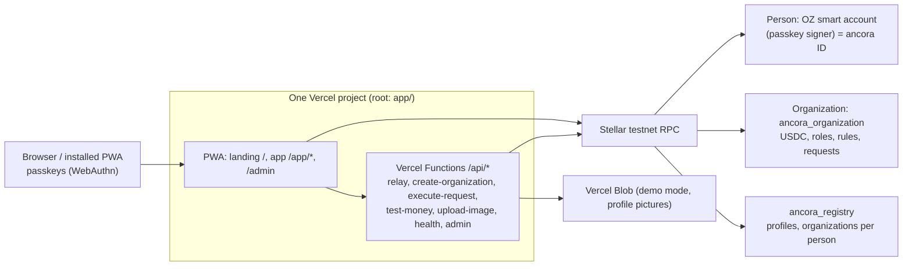

# Architecture

> Living document. Sections marked *(planned)* describe the target design and are filled in as each task lands.

## What runs where

- **Static app**: Vite build served by Vercel; every path except `/api/*` rewrites to `index.html` so deep links survive refresh. A Workbox service worker precaches the shell for installability and offline start.
- **Server-side** (`app/api/`): thin handlers calling adapters. Secrets live only in Vercel environment variables. The operator key sponsors fees, deploys organization contracts and executes due requests; it is never a member or signer anywhere.
- **Source of truth**: the Stellar testnet (identities, organizations, rules, requests, balances). No database (see DECISIONS.md).

## Front-end layering

`app/src/domain` (pure) ← `app/src/adapters` (outside world, behind interfaces) ← `app/src/features/*` (UI) using `app/src/ui` (presentational) and `app/src/styles/tokens.css` (design tokens). `app/shared/` holds the few modules both the app and the Functions import (token balance read, policy document).

## Approval rules engine

Pure TypeScript in `app/src/domain/rules/`, no I/O:

| Module | Responsibility |
|--------|----------------|
| `model.ts` | Org, roles (ranked, 0 = highest), members, policy (tiers, seal threshold, new-recipient rule), errors |
| `templates.ts` | Club, company and team defaults |
| `policy.ts` | Policy validation; payment evaluation (tier, required approvals, objection window, seal); governance evaluation (strictest tier) |
| `approvals.ts` | Slot matching: requester excluded, one slot per person, higher roles fill lower slots |
| `requests.ts` | Request lifecycle: pending → scheduled (objection window) → ready → executed, or declined |
| `governance.ts` | Member/rule/template changes, setup phase, template switching by rank, lock-out guard |
| `policyDocument.ts` | The rules as one canonical document (`ancora: "policy/1"`) and its SHA-256 |

The same behaviour is pinned by `contracts/test-vectors/approval-rules.json`, which `contracts/organization/src/rules.rs` tests against too (`test_vectors.rs`). The TypeScript engine is what sample mode runs and what the UI uses for previews; on testnet the contract decides.

## Identity model

| Thing | On-chain | Created by | Signs with |
|-------|----------|------------|------------|
| Person ("ancora ID") | OpenZeppelin smart account, WebAuthn signer = the person's passkey public key | smart-account-kit in the browser, deterministic address from the credential id | The passkey on the device (private key never leaves the authenticator) |
| Organization | `ancora_organization` instance: balances in its accepted stablecoins, roles (OZ AccessControl, admin = the contract itself), policy + policy-document hash, requests | The operator (`/api/create-organization`) with the founder as its only member, the rules' currency and the initial assets | Nobody: the contract acts when its own rules are satisfied |
| Registry | one `ancora_registry`: profile per address (name, picture URL), organizations per address, set of registered organizations | The setup script once | Profile: the person; memberships: the organization contract; registration: the operator |

One passkey, one person, any number of positions: the same address is a board member here and a treasurer there. Membership is a role grant on the organization contract plus an index entry in the registry, so a new device finds everything from the passkey alone (`connectWallet` → `orgs_of` → each organization's state).

## Contracts

`contracts/` (Rust, soroban-sdk 28, stellar-access 0.8):

- **`recovery`** (Lifeline): per person a `Plan { guardians, threshold, wait_seconds }` and at most one `Claim { successor, approvals, started_at, ready_at }`; `set_plan`/`clear_plan` (person), `start_claim`/`approve_claim` (a guardian), `cancel_claim` (person), `finish_claim(person, orgs)` (no auth; needs threshold and time, then calls `recover_member` on each registered organization and records `recovered_to`), views `plan`, `claim`, `protects(guardian)`, `recovered_to`. The organization's `recover_member(old, new)` requires the recovery contract's authorization (satisfied as the direct invoker) and moves role, spending limit and founder flag, then updates the registry. `/api/finish-recovery` filters the person's organizations to those built with the recovery contract and submits the call. Errors 1–9 are mapped in `adapters/testnet/lifelineContract.ts`.
- **Secure handover**: `Payment.escrow` makes `execute_now` set `Status::Escrowed` instead of paying; `confirm_escrow(by, id)` records the recipient's or the sender side's confirmation in `DataKey::Escrow(id)` and pays out when both are there; `cancel_escrow` (sender side) frees the committed amount and budget booking; `escrow(id)` is the view. The app mirrors it in `domain/rules/requests.ts` (`confirmEscrow`, `cancelEscrow`) and `domain/account.ts` (`payOutEscrow`); the recipient page `features/escrow/EscrowPage.tsx` reads the organization's request directly.
- **Budgets and the statement**: budgets are `Policy.budgets` in the organization contract (`Budget { category, amount, period_seconds, hard }`); `propose_payment` takes an optional category, books the amount in `DataKey::BudgetUse(category)` with a rolling window and marks `Evaluation.over_budget` (strictest tier) or refuses (`BudgetExceeded`, hard); `decline` releases; the `budgets` view lists what was booked. `domain/budgets.ts` mirrors that for previews and sample data, `domain/statement.ts` exports the CSV; `features/rules/BudgetsRulesCard.tsx` edits through `UpdatePolicy`, `ui/BudgetMeter.tsx` renders the meters on Rules and Overview.
- **Money view**: `features/overview/MoneyHeadline.tsx` sums every asset in the home currency (other currencies through `domain/fx.ts` quotes from `adapters/fx/frankfurterRates.ts`, URL `VITE_FX_RATES_URL`, with `indicativeRates.ts` as the labeled fallback) and shows available, waiting and Reserve as an allocation bar. Display only; the rules never read these rates.
- **Bank ramps**: `adapters/testnet/anchorRamp.ts` reads the anchor's stellar.toml (SEP-1), signs people in with their wallet through Stellar Wallets Kit (SEP-10, challenge checked with the SDK's `WebAuth.readChallengeTx`), starts SEP-24 interactive deposits and withdrawals and polls `/transaction`. `RampSupport` on the data source hides this from the UI (`BankDepositSection`, `BankWithdrawSheet`); sample data has none.
- **`organization`**: `__constructor(registry, base_currency, assets, founder, founder_role, template, name, policy_hash)`; views `info`, `policy`, `policy_hash`, `assets`, `members`, `is_setup_phase`, `request_count`, `requests(offset, limit)`, `request`, `has_paid`, `available(token)`; commands `propose_payment(by, token, to, amount, memo)`, `propose_change`, `change_directly` (founder, setup phase), `approve`, `seal`, `decline`, `execute`, `move_to_reserve`, `withdraw_from_reserve`, `set_logo` (top role). `spending_limits` lists members' allowances; `Change::SetSpendingLimit(member, amount, period)` grants or removes one, and `propose_payment` books a payment against the requester's rolling window when it fits (then nothing needs approval). `rules.rs` is the pure engine (same semantics as the TypeScript one), `templates.rs` the three templates, `types.rs` the errors (1–29) and data types. Requests snapshot their evaluation; a fully approved request with an objection window becomes `Scheduled` with `execute_after`, otherwise executes at once (token transfer with contract-invoker auth, or the membership/rule/asset change plus `registry.set_membership`). Events: `RequestEvent` per state change.

**Assets.** An organization accepts a list of tokens (`Asset { token, currency, symbol, decimals }`; symbol and decimals are read from the token contract when it is accepted, so a non-token address is refused). Balances live in the token contracts; the organization tracks what open payment requests have promised per token (`available(token)`). `Change::AddAsset(AssetSpec)` and `Change::RemoveAsset(token)` go through governance like rule changes; removing needs a zero balance, no open request in that token, and at least one other asset. The rules are written in `base_currency`; `evaluate_payment` receives `Some(amount)` for a token of that currency and `None` for any other, which selects the strictest tier and the seal (no rate is assumed).
- **`registry`**: `register_org` (operator), `set_membership` (the organization itself), `orgs_of`, `is_registered`, `set_profile(who, name, avatar)` (the person), `profile`.
- **`seal_verifier`**: `verify(signature_payload, key_data, sig_data) -> bool` checks an ML-DSA-44 (FIPS 204) signature over the 32-byte payload (empty context), plus `canonicalize_key` / `batch_canonicalize_key` (identity), which is OpenZeppelin's external-verifier interface. Stateless; one instance per network. Next step: the approving device holds an ML-DSA key (`@noble/post-quantum`), the person's smart account lists it as an external signer on a context rule for `seal`, and the seal is signed with it instead of the passkey.
- Shared with the kit's testnet deployments: the OZ smart account WASM, WebAuthn and Ed25519 verifiers, threshold and spending-limit policies (unused by the organization contract; see DECISIONS on spending limits).

**Reserve.** An asset may carry a DeFindex vault (`Asset.vault`). `move_to_reserve(by, token, amount)` and `withdraw_from_reserve(by, token, amount)` need no request (money never leaves the organization) but require treasury rights: the top role, or a role that could approve the strictest tier. The contract calls the vault directly (`deposit(amounts, mins, org, invest = true)`, `withdraw(shares, mins, org)`), pre-authorizing the vault's `token.transfer(org, vault, amount)` as a sub-invocation; the vault is also the share token, so `balance(org)` plus `get_asset_amounts_per_shares` give the Reserve's value, and the contract keeps the principal per token so the app can show earnings. `reserve(token)` returns vault, shares, value and principal.

**Policy document.** The app builds version 3 `{ ancora: "policy/3", template, roles, unit: "cent", currency, tiers, sealThreshold, newRecipientApprovals, budgets }` in the canonical form of stellar-registry/perch (CANON v1: no whitespace, sorted keys, `u32` numbers only, amounts as decimal strings, no null, no booleans) and hashes it with plain SHA-256; version 2 (numbers, nulls, no budgets) is still computed to verify older organizations. The hash goes into the constructor and into every `UpdatePolicy` change; the Rules page recomputes it from the contract's state and shows whether it matches. The design follows stellar-registry/perch (declarative policy IR lowered onto OZ accounts) without depending on it; per-call constraints can be added as an IR layer later; cumulative limits are the organization contract's own spending limits (task 9, see DECISIONS).

## Data sources

Features never talk to the outside world directly. They use one `DataSource` interface (`app/src/domain/dataSource.ts`): a snapshot of the person's workspace plus commands, an optional `identity` (sign-in, sign-out, profile) for sources where the person is real, an optional `funding` capability (connect a Stellar wallet, deposit into an organization) that the testnet adapter backs with Stellar Wallets Kit, loaded on demand (`walletFunding.ts`), and `discussions` (post, react, mark answered), whose entries travel with the snapshot (`OrgAccount.discussions`): sample data keeps them in the browser store, the testnet adapter reads and writes them through `/api/discussions` (Vercel Blob, membership checked on-chain).

| Implementation | Where | Status |
|----------------|-------|--------|
| `SampleDataSource` | `app/src/adapters/sample/` | Labeled sample data; every command runs through the domain engine; persisted in browser storage; "Viewing as" instead of sign-in. Stays as the demo fallback. |
| `TestnetDataSource` | `app/src/adapters/testnet/` (lazy-loaded chunk) | Real on Stellar testnet. Reads: registry `orgs_of`, each organization's `info/policy/assets/members/requests/is_setup_phase/policy_hash`, one token balance per accepted asset, `reserve(token)` for assets with a vault, profiles; all by simulation (`readContract.ts`), mapped by `mapOrganization.ts`, refreshed every 30 s. Commands: `kit.executeAndSubmit(organization, fn, args)` through the person's account (passkey prompt, fees sponsored by `/api/relay`), including Reserve moves; organization creation, execution of due requests and picture uploads through the Functions. |

**Choosing the source.** On load the app asks `/api/health` (site-wide demo mode from Vercel Blob, plus whether the Stellar RPC answers; 4 s timeout). `resolveDataSource` combines that with the person's own preference: sample data never waits for the network; the testnet is used only when the build has its configuration and the RPC is reachable, otherwise sample data is shown with the reason in the banner and a retry. On testnet the app then restores the passkey session or shows the sign-in page (create a passkey = create your account; sign in = reuse one; or look around with sample data).

UI state lives in `features/workspace` (snapshot and identity via `useSyncExternalStore`, preferences, active org). `useCommand` gives every action the same UX: signature prompt (simulated only in sample mode and for the seal) → command → plain-language success or error. `features/profile` is the person's page, `features/settings` the organization's.

## Auth flows

- **Sign-up:** smart-account-kit creates a passkey (RP ID = the production hostname) and deploys the OZ smart account with that passkey as its WebAuthn signer; the address is derived from the credential id, so one passkey always maps to one account. The person then writes their profile to the registry (`set_profile`, signed with the passkey).
- **Sign-in:** `connectWallet` restores the stored session silently, or prompts for a passkey on this device; the app reads the person's organizations from the registry.
- **Organization commands** (`propose_payment`, `approve`, `seal`, `decline`, `propose_change`, `change_directly`): the person's account calls the organization (`execute(target, fn, args)`); the organization calls `member.require_auth()`, which Soroban treats as authorized because the account is the direct invoker; the passkey signs the account's auth entry; `__check_auth` verifies it on-chain. The organization contract applies its rules; the app only mirrors them for previews and error text.
- **Payments:** when a request is satisfied (and its objection window, if any, has passed), the organization transfers the request's token from itself; `execute` is permissionless, so "Send now" lets the operator trigger it for due requests (`/api/execute-request`). Before requesting, the app checks that a classic recipient holds a trustline for exactly that asset.
- **Fee sponsoring:** the kit POSTs `{ func, auth }` to `/api/relay`. The Function re-validates (allowlisted WASM/functions, `execute` only towards ancora contracts, authorizations only from the smart account, exact match between `func` and the authorized call, simulated fee ≤ cap) and only then submits with the operator key as the fee-paying source. The operator signs the envelope, never an authorization.
- **Operator calls** (create organization, register it, test money per asset, execute due requests): plain invocations signed by the operator key; each checks the target is an ancora contract (WASM hash) and that assets come from the `ORG_ASSETS` allowlist, and nothing else.

### Testnet rent (why fees are high right now)

Measured 25 Oct 2026: testnet's live Soroban state is above its 4 GB rent target (4.10 GB and rising), so rent is 2,271,304 stroops/KB (mainnet: 1,000). The OZ smart account extends every persistent entry to a 30-day TTL on each read (`SMART_ACCOUNT_EXTEND_AMOUNT`). Together: deploy 22 XLM, first deposit 22 XLM, first passkey payment 46 XLM on testnet; the same on mainnet is well under 1 XLM. The relayer therefore sponsors from a Friendbot-refilled operator key instead of OpenZeppelin Relayer Channels (100 XLM/day cap).

## Recovery *(planned, task 17/18)*

A dedicated recovery contract per organization holds guardians and a threshold; guardians sign claims there, a waiting period runs, any current signer can cancel, then the claim swaps or adds a signer. Only the recovery contract is authorized on the account for that, through a `CallContract` context rule, so guardians never hold a rule on the account itself. Recovery devices (a second passkey on the person's own account) are added by the person's existing passkey after a QR pairing; see ROADMAP.md.

## Multi-tenancy

One person, many organizations, a role per organization; full isolation between organizations (separate contracts, separate balances); the registry is the only shared index and holds no money.
