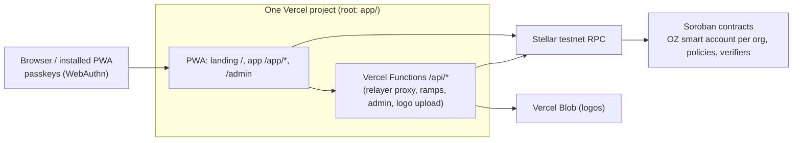

# Architecture

> Living document. Sections marked *(planned)* describe the target design and are filled in as each task lands.

## What runs where

- **Static app**: Vite build served by Vercel; every path except `/api/*` rewrites to `index.html` so deep links survive refresh. A Workbox service worker precaches the shell for installability and offline start.
- **Server-side** (`app/api/`): thin handlers calling adapters. Secrets live only in Vercel environment variables.
- **Source of truth**: the Stellar testnet (accounts, rules, requests, balances). No database by default (see DECISIONS.md).

## Front-end layering

`app/src/domain` (pure) ← `app/src/adapters` (outside world, behind interfaces) ← `app/src/features/*` (UI) using `app/src/ui` (presentational) and `app/src/styles/tokens.css` (design tokens).

## Contracts *(planned)*

One OpenZeppelin smart account per organization; everything else is a module on it: signers (passkeys, ML-DSA via external verifier), policies (approval rules, spending limits), connected contracts (DeFindex vault, confidential token). Shared stateless verifiers; multi-tenant policies keyed by smart account + context rule.

## Auth flows *(planned)*

Passkey (WebAuthn) signatures verified by the smart account; fees sponsored by a relayer so users never hold XLM.

## Multi-tenancy *(planned)*

One person, many organizations, a role per organization; full isolation between orgs.
